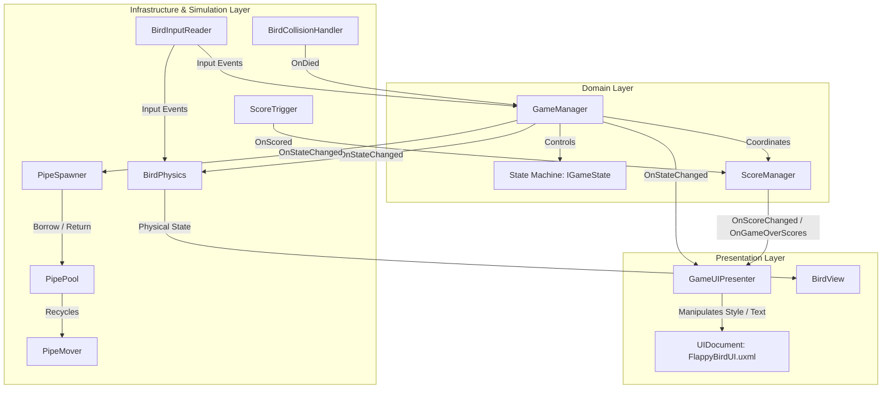
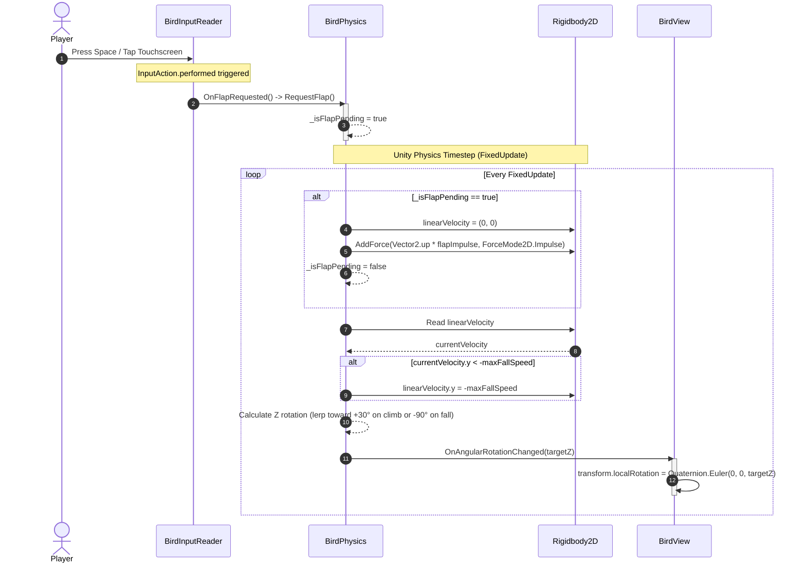
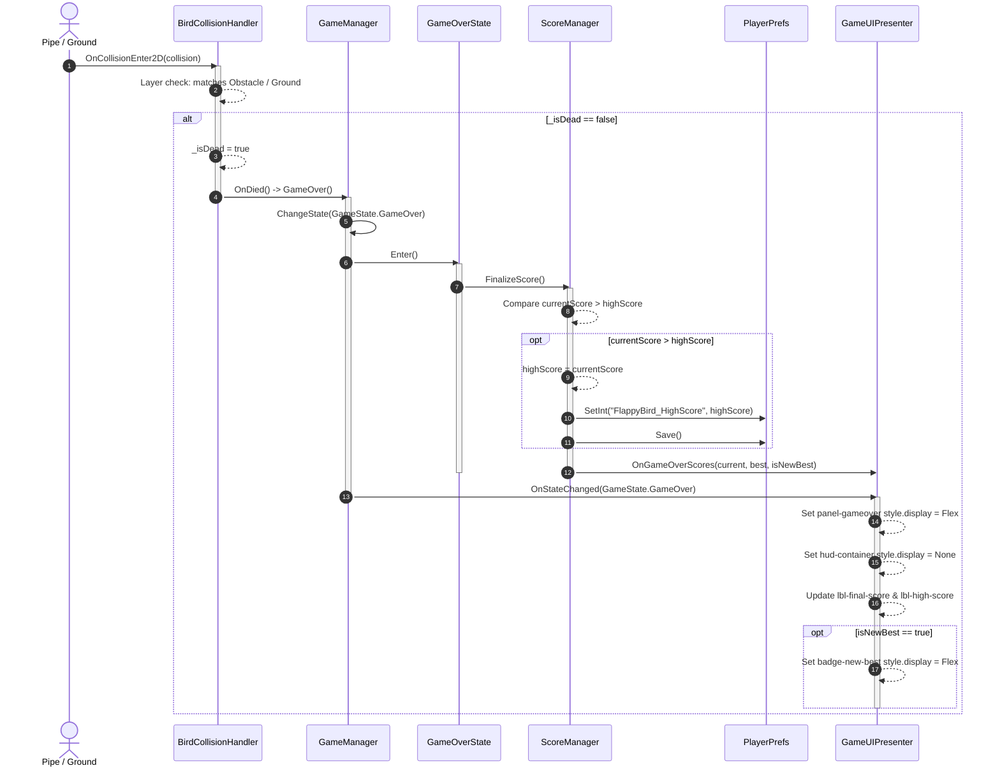
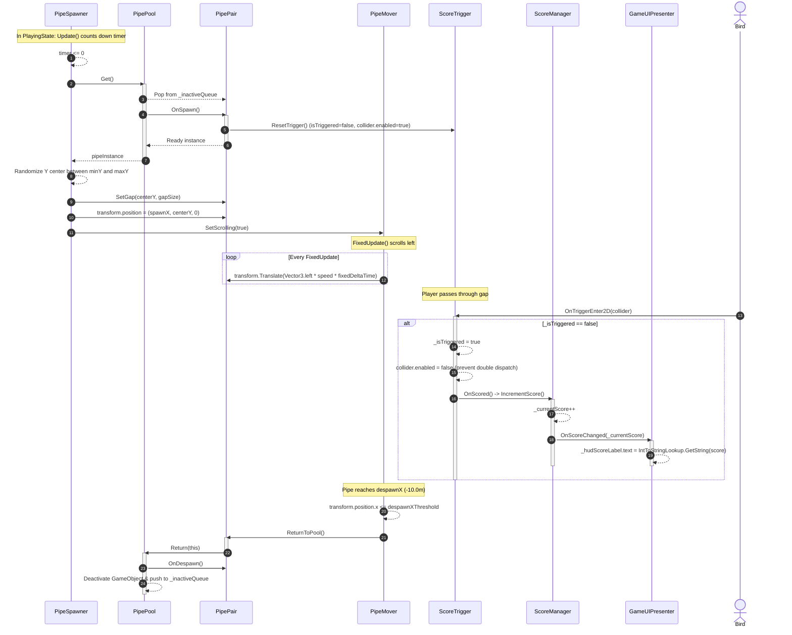
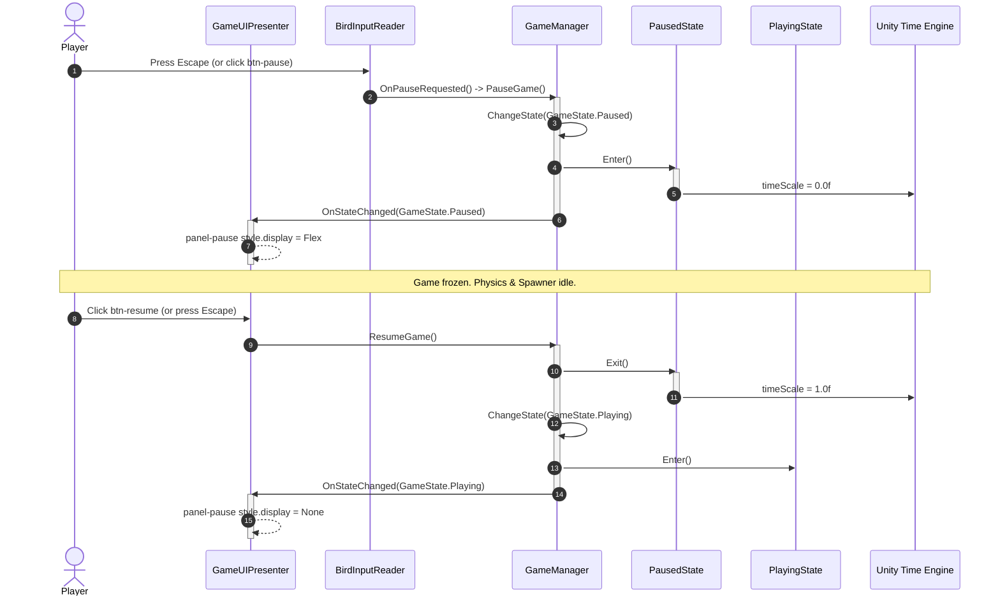

# Technical Design: 2D Flappy Bird Architecture

## 1. Technical Approach & Architecture Strategy

### 1.1 Architectural Overview
The technical design of this Flappy Bird implementation follows Clean Architecture principles tailored for Unity 6 (6000.5.9f1). The system strictly segregates responsibilities across three decoupled layers:
1. **Domain Layer**: Pure game state progression, scoring invariants, and lifecycle transitions without dependencies on physics simulations or view technologies.
2. **Infrastructure & Simulation Layer**: Concrete hardware-level and engine adapters. This includes New Input System event subscriptions (`BirdInputReader`), `Rigidbody2D` physical impulse and velocity constraints (`BirdPhysics`), collision filtering (`BirdCollisionHandler`), and pre-warmed object pooling with horizontal scroll transforms (`PipePool`, `PipeMover`, `PipeSpawner`, `ScoreTrigger`).
3. **Presentation Layer**: UI Toolkit reactive presentation (`GameUIPresenter` querying and manipulating `UIDocument` elements styled with USS Flexbox) and procedural visual rotations (`BirdView`).



### 1.2 Boundary Isolation & Event Contracts
Components never hold direct circular references. Communication across architectural boundaries is mediated exclusively through typed C# `event Action` delegates:
- `BirdInputReader.OnFlapRequested`: Dispatched asynchronously upon Input Action trigger; received by `BirdPhysics` (to queue jump) and `GameManager` (to start game from `ReadyState`).
- `BirdInputReader.OnPauseRequested`: Dispatched when Escape is triggered; received by `GameManager` (to toggle pause).
- `BirdCollisionHandler.OnDied`: Dispatched upon qualifying collision with pipe/ground; received by `GameManager` to enter `GameOverState`.
- `ScoreTrigger.OnScored`: Dispatched upon player passing through the vertical pipe gap; received by `ScoreManager` to increment the score.
- `GameManager.OnStateChanged`: Dispatched when the state machine completes a state transition; received by `GameUIPresenter`, `BirdPhysics`, and `PipeSpawner`.
- `ScoreManager.OnScoreChanged`: Dispatched on each score increase; received by `GameUIPresenter` to update HUD.
- `ScoreManager.OnGameOverScores`: Dispatched on game over; delivers run score, best score, and new high score flag to `GameUIPresenter`.

---

## 2. Architecture Decisions (ADRs)

### ADR-1: Input-to-Physics Handshake via Atomic Pending Flag
- **Context**: The New Input System operates on an asynchronous or frame-rate-dependent event loop (`InputAction.performed`). Directly calling `Rigidbody2D.AddForce` or modifying `linearVelocity` inside an input callback executes on the rendering thread or input update phase, leading to non-deterministic physics stepping, frame-rate dependent jump heights, and race conditions.
- **Decision**: 
  - `BirdInputReader` receives the `Flap` action callback and triggers `OnFlapRequested`.
  - `BirdPhysics` caches an internal atomic flag: `private bool _isFlapPending = false;`.
  - In `BirdPhysics.RequestFlap()`, `_isFlapPending` is assigned `true`.
  - In `BirdPhysics.FixedUpdate()`, if `_isFlapPending` is `true`:
    1. `_rb.linearVelocity = new Vector2(0f, 0f);` (or zeroes out Y component to cancel previous downward momentum).
    2. `_rb.AddForce(Vector2.up * _flapImpulse, ForceMode2D.Impulse);` (or sets `linearVelocity.y = _flapImpulse`).
    3. `_isFlapPending = false;`.
- **Consequences**:
  - Deterministic physics integration regardless of screen refresh rate (60Hz, 120Hz, or variable v-sync).
  - Multiple rapid clicks/taps within a single physics timestep ($0.02\,\text{s}$) coalesce safely into a single flap impulse rather than stacking exponential velocity.
  - Smooth visual results when paired with `Rigidbody2D.interpolation = RigidbodyInterpolation2D.Interpolate`.

---

### ADR-2: Obstacle Lifecycle via Pre-Warmed Object Pool (`IPoolable`)
- **Context**: Spawning and destroying pipe obstacles dynamically causes continuous heap allocations and Garbage Collector spikes. In a precision timing arcade game, GC collection hitches produce micro-stutters that cause player deaths.
- **Decision**:
  - Implement a dedicated zero-allocation `PipePool` managing composite `PipePair` GameObjects.
  - All pooled obstacles implement `IPoolable`:
    ```csharp
    public interface IPoolable
    {
        void OnSpawn();
        void OnDespawn();
    }
    ```
  - Pre-allocate a fixed pool of 8 `PipePair` instances at scene initialization (`Awake`).
  - Active pipes are held in a `List<PipePair>`, and inactive pipes are queued in a `Queue<PipePair>`.
  - On reaching `despawnXThreshold` (e.g. $-10.0\,\text{m}$), `PipeMover` delegates return to `PipePool.Return(pipePair)`.
  - Game resets reclaim active pipes via `PipePool.ResetAll()`, resetting transform coordinates and flags without destroying GameObjects.
- **Consequences**:
  - Runtime `Object.Instantiate()` and `Object.Destroy()` are strictly **zero** during active gameplay.
  - Memory footprint is static and predictable.

---

### ADR-3: Decoupled State Management via Finite State Machine (`IGameState`)
- **Context**: Managing game states via monolithic `switch(enum)` statements inside `Update()` results in sprawling conditional branches, fragile state resets, and high cyclomatic complexity.
- **Decision**:
  - Implement a formal State Pattern with an explicit `IGameState` contract:
    ```csharp
    public interface IGameState
    {
        void Enter();
        void Update();
        void FixedUpdate();
        void Exit();
    }
    ```
  - Define four discrete state classes: `ReadyState`, `PlayingState`, `PausedState`, `GameOverState`.
  - `GameManager` maintains state instances in an internal dictionary and delegates `Update()` / `FixedUpdate()` directly to `_currentState`.
  - State transitions are strictly guarded:
    - `ReadyState` $\to$ `PlayingState` (on first flap).
    - `PlayingState` $\to$ `PausedState` (on pause input) or `GameOverState` (on player death).
    - `PausedState` $\to$ `PlayingState` (resume) or `ReadyState` (restart).
    - `GameOverState` $\to$ `ReadyState` (restart).
- **Consequences**:
  - Complete isolation of state behaviors (e.g., `Time.timeScale` freeze isolated to `PausedState`; score finalization isolated to `GameOverState`).
  - Extensible architecture allowing post-death animation states or countdown sequences without modifying existing state logic.

---

### ADR-4: Presentation via UI Toolkit (`UIDocument` + Flexbox UXML/USS)
- **Context**: Legacy uGUI Canvas generates significant hierarchy overhead, requires deep nesting of RectTransforms, and causes Canvas mesh rebuilds whenever dynamic text elements change.
- **Decision**:
  - Use Unity UI Toolkit with a single `UIDocument` component hosting `FlappyBirdUI.uxml` styled by `FlappyBirdUI.uss`.
  - Configure `FlappyBirdPanelSettings.asset` using `Scale With Screen Size` ($1080 \times 1920$, match mode $0.5$ or width) for responsive multi-aspect layouts.
  - Drive view logic via `GameUIPresenter`:
    - Elements are queried and cached strictly once in `Awake()` / `OnEnable()` using `root.Q<T>()`.
    - Screen transitions toggle visual element visibility via `element.style.display = DisplayStyle.Flex` or `DisplayStyle.None`.
- **Consequences**:
  - Full separation of style (USS), markup (UXML), and reactive behavior (C# presenter).
  - Elimination of Canvas rebuild overhead. Zero DOM queries in `Update()`.

---

### ADR-5: Zero-GC Enforcement in Hot Lifecycles
- **Context**: Allocations in `Update()`, `FixedUpdate()`, or collision handlers trigger garbage collection pauses that break frame pacing.
- **Decision**:
  - **Component Lookups**: Prohibit `GetComponent<T>()`, `GetComponentInChildren<T>()`, and `GameObject.Find*()` inside all frame-by-frame loops. All references must be cached in `Awake()` or assigned via `[SerializeField]`.
  - **UI Strings**: Prohibit continuous string concatenation (e.g. `"Score: " + score`). Use an integer-to-string lookup table `IntToStringLookup` pre-caching string representations for values $0 \dots 999$.
  - **Delegates & Closures**: Prohibit anonymous lambda subscriptions with captured variables inside loops.
  - **Physics Buffers**: Layer masks and vector math reuse cached struct values.
- **Consequences**:
  - Constant **0 Bytes** managed memory allocation in the steady-state gameplay loop.

---

## 3. Class & Component Diagram

```mermaid
classDiagram
    direction TB

    %% Interfaces
    class IGameState {
        <<interface>>
        +Enter() void
        +Update() void
        +FixedUpdate() void
        +Exit() void
    }

    class IPoolable {
        <<interface>>
        +OnSpawn() void
        +OnDespawn() void
    }

    %% Core Domain
    class GameState {
        <<enumeration>>
        Ready
        Playing
        Paused
        GameOver
    }

    class GameManager {
        -IGameState _currentState
        -GameState _currentStateType
        -Dictionary~GameState, IGameState~ _stateMap
        -BirdPhysics _birdPhysics
        -BirdCollisionHandler _collisionHandler
        -BirdInputReader _inputReader
        -PipeSpawner _spawner
        -PipePool _pool
        -ScoreManager _scoreManager
        +GameState CurrentState
        +event Action~GameState~ OnStateChanged
        +ChangeState(GameState newState) void
        +StartGame() void
        +PauseGame() void
        +ResumeGame() void
        +GameOver() void
        +ResetGame() void
        +QuitGame() void
        -Awake() void
        -Start() void
        -Update() void
        -FixedUpdate() void
    }

    class ScoreManager {
        -int _currentScore
        -int _highScore
        -const string HIGH_SCORE_KEY
        +int CurrentScore
        +int HighScore
        +event Action~int~ OnScoreChanged
        +event Action~int, int, bool~ OnGameOverScores
        +Initialize() void
        +IncrementScore() void
        +ResetScore() void
        +FinalizeScore() void
    }

    class ReadyState {
        -GameManager _gm
        -BirdPhysics _birdPhysics
        -PipeSpawner _spawner
        -PipePool _pool
        -ScoreManager _scoreManager
        +ReadyState(GameManager gm, BirdPhysics bp, PipeSpawner sp, PipePool pool, ScoreManager sm)
        +Enter() void
        +Update() void
        +FixedUpdate() void
        +Exit() void
    }

    class PlayingState {
        -GameManager _gm
        -BirdPhysics _birdPhysics
        -PipeSpawner _spawner
        +PlayingState(GameManager gm, BirdPhysics bp, PipeSpawner sp)
        +Enter() void
        +Update() void
        +FixedUpdate() void
        +Exit() void
    }

    class PausedState {
        -GameManager _gm
        +PausedState(GameManager gm)
        +Enter() void
        +Update() void
        +FixedUpdate() void
        +Exit() void
    }

    class GameOverState {
        -GameManager _gm
        -BirdPhysics _birdPhysics
        -PipeSpawner _spawner
        -ScoreManager _scoreManager
        +GameOverState(GameManager gm, BirdPhysics bp, PipeSpawner sp, ScoreManager sm)
        +Enter() void
        +Update() void
        +FixedUpdate() void
        +Exit() void
    }

    %% Player Domain
    class BirdInputReader {
        -PlayerInputActions _inputActions
        +event Action OnFlapRequested
        +event Action OnPauseRequested
        -OnEnable() void
        -OnDisable() void
        -OnFlapPerformed(InputAction.CallbackContext ctx) void
        -OnPausePerformed(InputAction.CallbackContext ctx) void
    }

    class BirdPhysics {
        -Rigidbody2D _rb
        -float _flapImpulse
        -float _maxFallSpeed
        -float _maxUpwardAngle
        -float _maxDownwardAngle
        -float _tiltSmoothing
        -bool _isFlapPending
        +event Action~float~ OnAngularRotationChanged
        +Initialize(Rigidbody2D rb) void
        +RequestFlap() void
        +ResetPhysics(Vector2 startPosition) void
        +SetSimulated(bool isSimulated) void
        -FixedUpdate() void
        -ApplyFlapImpulse() void
        -ClampVelocity() void
        -CalculateProceduralRotation() void
    }

    class BirdCollisionHandler {
        -LayerMask _obstacleLayerMask
        -LayerMask _groundLayerMask
        -bool _isDead
        +event Action OnDied
        +ResetHandler() void
        -OnCollisionEnter2D(Collision2D collision) void
        -OnTriggerEnter2D(Collider2D collider) void
    }

    class BirdView {
        -Transform _visualTransform
        -BirdPhysics _birdPhysics
        +UpdateRotation(float zDegrees) void
        -Awake() void
        -OnEnable() void
        -OnDisable() void
        -HandleRotationChanged(float zDegrees) void
    }

    %% Obstacles Domain
    class PipePool {
        -PipePair _prefab
        -int _poolSize
        -Transform _poolRoot
        -Queue~PipePair~ _inactiveQueue
        -List~PipePair~ _activeList
        +Initialize() void
        +Get() PipePair
        +Return(PipePair pipe) void
        +ResetAll() void
    }

    class PipePair {
        -Transform _topPipe
        -Transform _bottomPipe
        -ScoreTrigger _scoreTrigger
        -PipeMover _mover
        -PipePool _originPool
        +Initialize(PipePool pool) void
        +SetGap(float centerY, float gapSize) void
        +OnSpawn() void
        +OnDespawn() void
        +ReturnToPool() void
    }

    class PipeMover {
        -float _scrollSpeed
        -float _despawnX
        -PipePair _parentPipe
        -bool _isScrolling
        +SetScrolling(bool isScrolling) void
        -FixedUpdate() void
    }

    class PipeSpawner {
        -PipePool _pool
        -float _spawnInterval
        -float _spawnX
        -float _minY
        -float _maxY
        -float _gapSize
        -float _timer
        -bool _isSpawning
        +SetSpawning(bool isSpawning) void
        +ResetSpawner() void
        -Update() void
        -SpawnPipe() void
    }

    class ScoreTrigger {
        -Collider2D _collider
        -bool _isTriggered
        +event Action OnScored
        +ResetTrigger() void
        -OnTriggerEnter2D(Collider2D other) void
    }

    %% UI Domain
    class GameUIPresenter {
        -UIDocument _uiDoc
        -GameManager _gameManager
        -ScoreManager _scoreManager
        -VisualElement _root
        -VisualElement _hudContainer
        -Label _hudScoreLabel
        -Button _btnPause
        -VisualElement _panelReady
        -VisualElement _panelPause
        -Button _btnResume
        -Button _btnRestartPause
        -Button _btnQuit
        -VisualElement _panelGameOver
        -Label _lblFinalScore
        -Label _lblHighScore
        -VisualElement _badgeNewBest
        -Button _btnRestart
        -Awake() void
        -OnEnable() void
        -OnDisable() void
        -HandleStateChanged(GameState newState) void
        -HandleScoreChanged(int newScore) void
        -HandleGameOverScores(int finalScore, int highScore, bool isNewBest) void
        -SetElementVisible(VisualElement el, bool visible) void
    }

    class IntToStringLookup {
        <<static>>
        -static string[] _cache
        +static GetString(int value) string
    }

    %% Inheritance & Realizations
    IGameState <|.. ReadyState
    IGameState <|.. PlayingState
    IGameState <|.. PausedState
    IGameState <|.. GameOverState
    IPoolable <|.. PipePair

    %% Compositions and Relationships
    GameManager o-- IGameState : manages
    GameManager --> ScoreManager : owns
    GameManager --> BirdPhysics : controls
    GameManager --> BirdCollisionHandler : listens
    GameManager --> BirdInputReader : listens
    GameManager --> PipeSpawner : controls
    GameManager --> PipePool : controls

    BirdPhysics <-- BirdInputReader : invokes RequestFlap
    BirdView <-- BirdPhysics : receives rotation
    
    PipeSpawner --> PipePool : requests instance
    PipePool o-- PipePair : manages
    PipePair *-- PipeMover : contains
    PipePair *-- ScoreTrigger : contains
    
    GameUIPresenter ..> GameManager : listens
    GameUIPresenter ..> ScoreManager : listens
    GameUIPresenter --> IntToStringLookup : calls
```



---

## 4. Sequence Diagrams

### Sequence 1: Input to Flap Jump & Tilt Lerp
Demonstrates the decoupled input reception, atomic flag caching, `FixedUpdate` impulse application, velocity clamping, and procedural angular rotation dispatch.



---

### Sequence 2: Collision & Game Over Transition
Demonstrates collision detection, state machine transition to `GameOverState`, high score comparison, `PlayerPrefs` persistence, and Game Over modal display.



---

### Sequence 3: Obstacle Spawn, Movement, Scoring & Recycle
Demonstrates countdown spawning from `PipePool`, gap randomization, horizontal translation, one-shot score triggering, and pool return on boundary exceedance.



---

### Sequence 4: Pause & Resume Flow
Demonstrates pause handling via Escape key or UI button, `Time.timeScale` manipulation, modal visibility, and seamless resumption.



---

## 5. Detailed Class Contracts & File Structure

### 5.1 Core C# Interfaces

#### `IGameState.cs`
```csharp
namespace FlappyBird.Core
{
    /// <summary>
    /// Contract for finite state machine states governing the core game lifecycle.
    /// </summary>
    public interface IGameState
    {
        /// <summary>
        /// Executed once when the state machine enters this state.
        /// </summary>
        void Enter();

        /// <summary>
        /// Executed every frame during MonoBehaviour.Update while this state is active.
        /// </summary>
        void Update();

        /// <summary>
        /// Executed every physics step during MonoBehaviour.FixedUpdate while this state is active.
        /// </summary>
        void FixedUpdate();

        /// <summary>
        /// Executed once immediately before the state machine leaves this state.
        /// </summary>
        void Exit();
    }
}
```

#### `IPoolable.cs`
```csharp
namespace FlappyBird.Obstacles
{
    /// <summary>
    /// Contract for pooled GameObjects managed by a zero-allocation object pool.
    /// </summary>
    public interface IPoolable
    {
        /// <summary>
        /// Invoked when the object is retrieved from the pool to activate and re-prime components.
        /// </summary>
        void OnSpawn();

        /// <summary>
        /// Invoked when the object is returned to the pool to silence and deactivate components.
        /// </summary>
        void OnDespawn();
    }
}
```

---

### 5.2 Planned Directory Structure

```
Assets/
├── Prefabs/
│   ├── Bird.prefab                         # Player GameObject: Rigidbody2D, CircleCollider2D, Bird scripts
│   ├── PipePair.prefab                     # Composite obstacle: Top/Bottom pipes, ScoreTrigger, PipeMover
│   └── GameManager.prefab                  # Scene manager container: GameManager, ScoreManager, Spawner, Pool
├── Scripts/
│   ├── Core/
│   │   ├── GameState.cs                    # Enum: Ready, Playing, Paused, GameOver
│   │   ├── IGameState.cs                   # State machine interface contract
│   │   ├── GameManager.cs                  # Central lifecycle coordinator & state machine dispatcher
│   │   ├── ScoreManager.cs                 # Run score calculation & PlayerPrefs high score persistence
│   │   └── States/
│   │       ├── ReadyState.cs               # Suspended state; awaits initial flap input
│   │       ├── PlayingState.cs             # Active gameplay; enables physics, spawner, and triggers
│   │       ├── PausedState.cs              # Zero timescale state; modal pause menu
│   │       └── GameOverState.cs            # Death state; halts movement, calculates scores, shows modal
│   ├── Player/
│   │   ├── BirdInputReader.cs              # New Input System event subscriber (zero Update polling)
│   │   ├── BirdPhysics.cs                  # Rigidbody2D impulse, terminal fall clamping, tilt calculation
│   │   ├── BirdCollisionHandler.cs         # Layer-filtered collision detection & death dispatcher
│   │   └── BirdView.cs                     # View presentation; rotates visual transform based on physics
│   ├── Obstacles/
│   │   ├── IPoolable.cs                    # Object pool lifecycle interface
│   │   ├── PipePool.cs                     # Pre-warmed zero-GC object pool
│   │   ├── PipePair.cs                     # Composite pooled pipe entity
│   │   ├── PipeMover.cs                    # FixedUpdate horizontal translation & despawn detection
│   │   ├── PipeSpawner.cs                  # Interval countdown spawner with randomized gap positioning
│   │   └── ScoreTrigger.cs                 # Single-entry score pass trigger
│   └── UI/
│       ├── GameUIPresenter.cs              # UI Toolkit presenter; queries DOM and handles reactivity
│       └── IntToStringLookup.cs            # Static lookup table for numbers 0-999 (zero heap allocations)
├── Settings/
│   └── Input/
│       └── PlayerInputActions.inputactions # Input Action Asset (Gameplay Map: Flap, Pause)
└── UI/
    ├── FlappyBirdUI.uxml                   # UI Toolkit visual hierarchy (HUD, Ready, Pause, GameOver)
    ├── FlappyBirdUI.uss                    # Flexbox stylesheet (typography, layout, buttons, modals)
    └── FlappyBirdPanelSettings.asset       # PanelSettings (Scale With Screen Size: 1080x1920, Match 0.5)
```

---

### 5.3 Planned Unity Scene GameObject Hierarchy

```
SampleScene
├── Main Camera                             [Camera: Orthographic Size 5.0, Clear Flags: Solid Color #70C5CE]
├── Environment
│   ├── Ground                              [Transform: (0, -4.5, 0), SpriteRenderer: Box, BoxCollider2D: Layer "Ground"]
│   └── Ceiling                             [Transform: (0, 5.5, 0), SpriteRenderer: Box, BoxCollider2D: Layer "Ground"]
├── Managers                                [Transform: (0, 0, 0)]
│   ├── GameManager                         [GameManager]
│   ├── ScoreManager                        [ScoreManager]
│   ├── PipePool                            [PipePool: PoolSize 8, Prefab: PipePair.prefab]
│   │   └── PoolContainer                   [Transform: Holds 8 inactive PipePair instances]
│   └── PipeSpawner                         [PipeSpawner: SpawnInterval 1.6, SpawnX 10.0, MinY -1.5, MaxY 2.0]
├── Bird                                    [Transform: (-1.5, 0, 0), Layer "Player"]
│   ├── Rigidbody2D                         [Interpolate, Continuous, FreezeRotation Z, GravityScale 2.5]
│   ├── CircleCollider2D                    [Radius 0.4, isTrigger: false]
│   ├── BirdInputReader                     [PlayerInputActions reference]
│   ├── BirdPhysics                         [FlapImpulse 7.5, MaxFallSpeed 10.5, TiltSmoothing 15.0]
│   ├── BirdCollisionHandler                [LayerMask: Obstacle | Ground]
│   └── BirdVisual                          [BirdView, SpriteRenderer: Circle Primitive, Color #FFD700]
└── UI
    └── UIDocument                          [UIDocument: PanelSettings = FlappyBirdPanelSettings, VisualTree = FlappyBirdUI]
        └── GameUIPresenter                 [GameUIPresenter]
```

#### Detailed PipePair Prefab Structure:
```
PipePair.prefab                             [Transform, PipePair, PipeMover: ScrollSpeed 3.5, DespawnX -10.0]
├── TopPipe                                 [Transform: (0, 3.5, 0), SpriteRenderer: Box #2ECC71, BoxCollider2D: Layer "Obstacle"]
│   └── PipeCap                             [Transform: (0, -1.8, 0), SpriteRenderer: Box #27AE60]
├── BottomPipe                              [Transform: (0, -3.5, 0), SpriteRenderer: Box #2ECC71, BoxCollider2D: Layer "Obstacle"]
│   └── PipeCap                             [Transform: (0, 1.8, 0), SpriteRenderer: Box #27AE60]
└── ScoreZone                               [Transform: (0, 0, 0), ScoreTrigger, BoxCollider2D: Size (0.5, 3.2), isTrigger: true]
```

---

## 6. Verification & Profiling Plan

### 6.1 Deterministic Simulation Verification
- **Impulse Consistency**: Record velocity immediately following `RequestFlap()` in `FixedUpdate`. Verify vertical velocity equals $7.5\,\text{m/s} \pm 0.01\,\text{m/s}$ across various simulation framerates ($30\,\text{Hz}, 50\,\text{Hz}, 60\,\text{Hz}, 120\,\text{Hz}$).
- **Terminal Fall Clamping**: Drop the bird from $Y = 5.0$ without input. Ensure vertical speed saturates at $-10.5\,\text{m/s}$ and does not tunnel through the ground box collider.
- **Physics Interpolation**: Observe visual bird position on high refresh displays ($144\,\text{Hz}$); confirm absence of micro-jitter due to `RigidbodyInterpolation2D.Interpolate`.

### 6.2 Zero-Allocation & GC Profiling Checklist
Run the Unity Profiler with Deep Profile disabled during a continuous 60-second gameplay session:
1. **`Update()` GC Allocation**: Must measure strictly **0 B**.
2. **`FixedUpdate()` GC Allocation**: Must measure strictly **0 B**.
3. **`OnScoreChanged` Invocation**: Must measure strictly **0 B** via `IntToStringLookup` cache lookup.
4. **`PipePool.Get()` & `Return()`**: Must measure strictly **0 B** heap allocation (queue dequeue/enqueue without array resizes).
5. **UI Toolkit DOM Modifications**: Must produce **0 B** managed allocations per frame when styles or text values are altered.

### 6.3 State Machine Transition Matrix Verification
Verify all valid transitions and confirm that invalid transitions are rejected:

| Origin State | Event / Trigger | Target State | Post-Condition Verification |
| :--- | :--- | :--- | :--- |
| **`ReadyState`** | `OnFlapRequested` | `PlayingState` | Physics simulated enabled, first impulse applied, spawner timer starts. |
| **`PlayingState`** | `OnPauseRequested` / Pause UI | `PausedState` | `Time.timeScale == 0f`, `#panel-pause` visible. |
| **`PlayingState`** | `OnDied` (Collision) | `GameOverState` | `Time.timeScale == 1f`, high score saved, `#panel-gameover` visible. |
| **`PausedState`** | Resume UI / `OnPauseRequested` | `PlayingState` | `Time.timeScale == 1f`, `#panel-pause` hidden, game continues. |
| **`PausedState`** | Restart UI | `ReadyState` | Active pipes recycled, bird reset to $(-1.5, 0.0)$, score reset to $0$. |
| **`GameOverState`** | Restart UI | `ReadyState` | Active pipes recycled, bird reset to $(-1.5, 0.0)$, `#panel-ready` visible. |
| **`ReadyState`** | `OnPauseRequested` | Rejected | No state change; game remains in `ReadyState`. |
| **`GameOverState`** | `OnFlapRequested` | Rejected | Flap input ignored; no physics impulse. |
