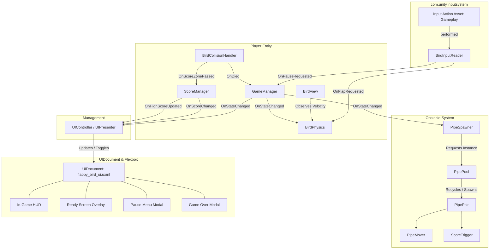
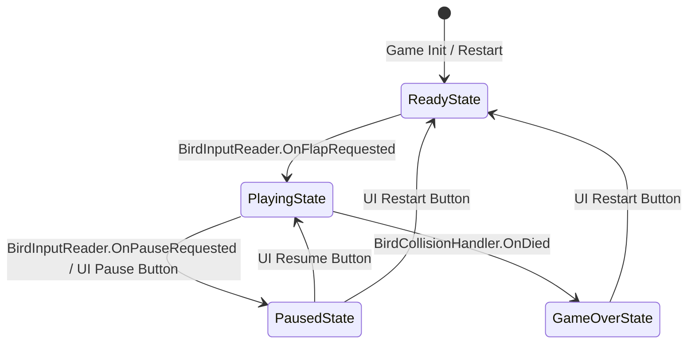

# SDD Exploration: Flappy Bird 2D (Unity URP)

## 1. Executive Summary

### 1.1 Overview & Objective
The goal of this initiative is to design and develop an ultra-responsive, deterministic, and arcade-authentic 2D **Flappy Bird** clone built natively in **Unity 6 (6000.5.9f1)** using the **Universal Render Pipeline (URP 2D)**, the **New Unity Input System (`com.unity.inputsystem`)**, and **Unity UI Toolkit (`UIDocument`, UXML, USS)**.

### 1.2 Development Philosophy: Mockup-First & Clean Architecture
1. **Mockup-First Visual Architecture**:
   - All gameplay entities (Bird, Pipes, Ground, Triggers) are initially constructed using Unity 2D Sprite Primitives (Circle, Square) with flat color materials and unlit shaders.
   - Eliminates asset-pipeline blockers; visual representation is strictly isolated from physics simulation and game logic, enabling seamless drop-in replacement with spritesheets, particle systems, and audio later.
2. **Modern Input & UI Subsystems**:
   - **New Unity Input System (`com.unity.inputsystem`)**: Pure event-driven input processing. No frame-by-frame polling in `Update()`. Input callbacks handle cross-platform actions (Keyboard, Mouse, Touchscreen) and synchronize cleanly with physics.
   - **UI Toolkit Flexbox Architecture**: Completely replaces traditional legacy uGUI / Canvas hierarchies. Uses `UIDocument`, semantic UXML templates, and USS flexbox stylesheets. UI controllers cache elements once at startup, maintaining zero dynamic queries and zero GC allocations in `Update()`.
3. **Strict Performance & Unity Lifecycle Guarantees**:
   - **Zero Dynamic GC in Hot Loops**: Strict prohibition of `GetComponent<T>()`, `Find()`, LINQ, string concatenation, or runtime heap allocations (`new`, closures, boxing) inside `Update()`, `FixedUpdate()`, or collision callbacks.
   - **FixedUpdate Physics Discipline**: Event-driven input sets an atomic pending flag; all physics calculations, velocity clamping, and Rigidbody2D forces run strictly in `FixedUpdate()`.
   - **Pre-warmed Object Pooling**: Zero runtime `Instantiate` or `Destroy` calls during active gameplay. All obstacles, pipes, and triggers are pooled and recycled via an `IPoolable` lifecycle.
4. **SOLID Clean Architecture**:
   - Monolithic controllers (e.g. traditional `BirdController`) are completely dismantled into Single Responsibility components (`BirdInputReader`, `BirdPhysics`, `BirdCollisionHandler`, `BirdView`).
   - UI logic is partitioned into an event-driven `UIController` / `UIPresenter` decoupled from game simulation.
   - Decoupled event-driven communication (C# `event Action`) and an explicit State Machine pattern (`IGameState`) eliminate direct cross-system dependencies.

---

## 2. Game Design Specification (GDD)

### 2.1 High Concept & Target Platform
- **High Concept**: Guide a continuously falling bird through randomized vertical pipe obstacles using single-button tap impulses.
- **Genre**: 2D Physics Arcade / Endless Runner.
- **Target Platform**: Desktop (Spacebar / Left Mouse Click / Escape for Pause) and Mobile (Screen Touch / Tap).
- **Camera Perspective**: 2D Orthographic side view with static camera; world geometry scrolls leftwards while the player remains in a fixed horizontal column ($X \approx -1.5$).
- **Aspect Ratio & Resolution**: 9:16 Portrait reference ($1080 \times 1920$), scalable via UI Toolkit `PanelSettings` across dynamic mobile and desktop resolutions.

---

### 2.2 Core Mechanics & Physics Feel

#### Input Capture & Physics Synchronization
Because physics forces must be applied in `FixedUpdate` while user inputs occur asynchronously via the New Input System's event thread:
1. `BirdInputReader` registers callbacks on `InputAction.performed` (listening to the "Gameplay/Flap" action).
2. When the callback fires, it sets an atomic flag: `_isFlapPending = true` (or dispatches `OnFlapRequested`).
3. `BirdPhysics.FixedUpdate()` evaluates `_isFlapPending`. If true:
   - Resets vertical velocity: $V_y = 0$.
   - Applies upward impulse: $V_y = \text{jumpForce}$ (e.g., $7.5\,\text{m/s}$).
   - Clears `_isFlapPending = false`.
4. Guarantees frame-rate independence: zero missed clicks under frame drops, zero multi-force stacking on high refresh displays, and zero input polling overhead in `Update()`.

#### Terminal Fall Velocity & Gravity Scaling
- **Gravity Scaling (`gravityScale`)**: Tuned between $2.8$ and $3.5$ for rapid, snappy downward acceleration.
- **Terminal Fall Velocity (`maxFallSpeed`)**: Downward velocity is clamped in `FixedUpdate`:
  $$V_y = \max(V_y, \text{maxFallSpeed}) \quad (\text{e.g., } \text{maxFallSpeed} = -10.5\,\text{m/s})$$
  This prevents physics tunneling through colliders and ensures predictable recovery windows across all jump heights.

#### Procedural Tilt & Visual Feedback
- **Tilt Interpolation**:
  - Upon flapping: Transform angle snaps instantly or rapidly interpolates towards $+25^\circ$ to $+30^\circ$.
  - While falling ($V_y < 0$): Smoothly rotates nose-down towards $-90^\circ$ proportionally to downward speed.
  - Calculated and applied in `BirdPhysics.FixedUpdate()` (or isolated `BirdView.Update()` for visual smoothing).

```
        Flap (+25°)         Peak (0°)          Diving (-90°)
           ↗                   →                    ↓
        ( O ) >             ( O ) >              ( O )
                                                   v
```

---

### 2.3 Obstacle & Environment System

#### Pipe Structure & Clearance Gap
- Each obstacle consists of a synchronized **Pipe Pair** (Top Pipe inverted, Bottom Pipe upright).
- **Vertical Gap ($G$)**: Constant clearance distance ($G \approx 3.0$ to $3.5$ units).
- **Gap Center Variation ($Y_{\text{center}}$)**: Randomly picked from a bounded uniform distribution:
  $$Y_{\text{center}} \in [Y_{\min}, Y_{\max}] \quad (\text{e.g., } [-2.0, +2.0])$$
  ensuring visible pipe bodies on both edges of the screen.

#### Scrolling & Recycled Despawning
- **Scroll Speed ($V_x$)**: Constant leftward speed ($-3.0\,\text{units/sec}$).
- **Spawn Interval**: Fixed timer or distance interval ($\Delta t \approx 1.6\,\text{seconds}$).
- **Despawn Boundary**: When pipe $X < X_{\text{despawn}}$ (e.g. $-10.0\,\text{units}$), the pipe pair is deactivated and returned to the `PipePool`.

---

### 2.4 Scoring & Progression

- **Score Trigger**: Invisible `BoxCollider2D` (`isTrigger = true`) centered between the top and bottom pipe columns.
- **Zero-Duplicate Score Registration**: On trigger entry, the trigger immediately deactivates its collider and dispatches `OnScored`.
- **Persistence**:
  - Session score tracked in `ScoreManager`.
  - Best score stored via `PlayerPrefs.GetInt("FlappyBird_HighScore", 0)`.
  - On game over, if `CurrentScore > HighScore`, high score is updated and saved.
  - Score updates notify the `UIController` via event `OnScoreChanged(int currentScore)`, which sets the UI Toolkit label text directly.

---

### 2.5 Visual Art Direction (Mockup Primitives)

| Entity | Primitive | Visual Dimensions | Color Coding (Mockup) | Layer / Order |
| :--- | :--- | :--- | :--- | :--- |
| **Bird Body** | 2D Circle Sprite | $\approx 0.7$ units dia | Canary Yellow (`#FFD700`) | Player / 10 |
| **Beak / Eye** | Small Circle / Triangle | $\approx 0.15$ units | Orange (`#E67E22`) / Black | Player / 11 |
| **Pipes (Top / Bottom)** | 2D Square Sprite (stretched) | Width: $1.2$, Height: $8.0$ | Emerald Green (`#2ECC71`) | Obstacle / 5 |
| **Pipe Caps** | 2D Square Sprite | Width: $1.4$, Height: $0.4$ | Darker Green (`#27AE60`) | Obstacle / 6 |
| **Score Trigger** | Box Collider (no renderer) | Width: $0.2$, Height: $3.5$ | Transparent Trigger | ScoreTrigger / 0 |
| **Ground Strip** | 2D Square Sprite | Width: $25.0$, Height: $1.5$| Khaki Dirt (`#D35400`) | Ground / 20 |
| **Sky / Backdrop** | Camera Background Color | Full Screen Viewport | Pale Cyan (`#70C5CE`) | Background / -10 |

---

## 3. Architecture & Clean Code Specification

### 3.1 SOLID Principles & Decoupled Responsibilities



---

### 3.2 Single Responsibility Breakdown

#### A. Player Subsystem (`Assets/Scripts/Player/`)
1. **`BirdInputReader.cs` (Input Handling via New Input System)**:
   - **Responsibility**: Manages the lifecycle of Unity's New Input System (`com.unity.inputsystem`).
   - **Action Map**: "Gameplay".
     - Action `Flap`: Primary bindings:
       - Keyboard: `<Keyboard>/space`
       - Mouse: `<Mouse>/leftButton`
       - Touch: `<Touchscreen>/primaryTouch/tap` (future-proof multiplatform support)
     - Action `Pause`:
       - Keyboard: `<Keyboard>/escape`
   - **Zero Polling Discipline**: Subscribes to `InputAction.performed` in `OnEnable()`, unhooks in `OnDisable()`. No input checks in `Update()`.
   - **Contract Events**:
     - `public event Action OnFlapRequested;`
     - `public event Action OnPauseRequested;`
   - **Lifecycle Filter**: Ignores flap inputs when game is in `GameOver` or `Paused` states.

2. **`BirdPhysics.cs` (Physics & Movement Only)**:
   - **Responsibility**: Controls `Rigidbody2D`, handles jump impulses, applies velocity clamping, and computes tilt rotation.
   - **Lifecycle**: Runs strictly in `FixedUpdate()`.
   - **Reference Caching**: `Rigidbody2D` cached in `Awake()`. Zero `GetComponent` calls during runtime.
   - **State Control**:
     - `Ready`: `rb.bodyType = RigidbodyType2D.Kinematic`, subtle bobbing or frozen.
     - `Playing`: `rb.bodyType = RigidbodyType2D.Dynamic`, gravity active, accepts flap impulses.
     - `Paused`: Velocity saved and frozen (`rb.simulated = false` or `Time.timeScale = 0`).
     - `GameOver`: Freezes rotation, disables flap consumption, allows natural fall to ground.

3. **`BirdCollisionHandler.cs` (Collisions Only)**:
   - **Responsibility**: Detects physical collisions and trigger encounters.
   - **Lifecycle**: `OnCollisionEnter2D` and `OnTriggerEnter2D`.
   - **Layer Filtering**: Uses cached layer bitmasks or direct tags to avoid string comparison allocations.
   - **Events**:
     - `OnDied`: Fired upon touching `Obstacle` or `Ground`.
     - `OnScoreZonePassed`: Fired upon entering `ScoreTrigger`.

4. **`BirdView.cs` (Visual Presentation Only)**:
   - **Responsibility**: Manages sprite color, particle emission, or future spritesheet animation frames.
   - **Decoupling**: Subscribes to `BirdPhysics` and `BirdCollisionHandler` events; contains no physics or gameplay logic.

---

#### B. Obstacle & Pooling Subsystem (`Assets/Scripts/Obstacles/`)
1. **`IPoolable.cs` (Pooling Interface)**:
   ```csharp
   public interface IPoolable
   {
       void OnSpawn();
       void OnDespawn();
   }
   ```
2. **`PipePool.cs` (Zero-GC Object Pool)**:
   - **Responsibility**: Pre-warms and manages a reusable pool of `PipePair` GameObjects (e.g., 6 to 8 instances).
   - **Implementation**: Utilizes `UnityEngine.Pool.IObjectPool<PipePair>` or a pre-allocated array ring-buffer.
   - **Guarantee**: Zero calls to `Instantiate` or `Destroy` while the player is in the gameplay loop.
   - **Reset**: Completely reclaims all active pipes when restarting or transitioning to `ReadyState`.

3. **`PipePair.cs` (Obstacle Composite)**:
   - Implements `IPoolable`.
   - Contains cached references to:
     - Top Pipe `Transform` and `Collider2D`.
     - Bottom Pipe `Transform` and `Collider2D`.
     - `ScoreTrigger` component.
     - `PipeMover` component.
   - Configures vertical gap position on `OnSpawn()`.

4. **`PipeMover.cs` (Translation Only)**:
   - **Responsibility**: Translates the pipe pair leftward:
     $$\Delta X = -V_x \cdot \Delta t$$
   - Monitored position: When `transform.position.x < despawnX`, calls `PipePool.Release(pipePair)`.
   - Pauses movement immediately on `GameOverState` and `PausedState`.

5. **`ScoreTrigger.cs` (Scoring Zone)**:
   - Attached to the gap between pipes.
   - Contains cached `Collider2D`.
   - On `OnTriggerEnter2D(Collider2D other)`: Checks for player layer, fires `OnScored`, and sets `collider.enabled = false` to guarantee single registration per pipe pass. Re-enabled on `OnSpawn()`.

6. **`PipeSpawner.cs` (Spawning Coordinator)**:
   - **Responsibility**: Timer-driven spawner that pulls available `PipePair` instances from `PipePool`.
   - Randomizes vertical gap center between $[Y_{\min}, Y_{\max}]$.
   - Listens to `GameManager.OnStateChanged` to start/stop the spawn timer.

---

#### C. State Machine & Game Flow (`Assets/Scripts/Core/`)



1. **State Machine Pattern (`IGameState`)**:
   ```csharp
   public interface IGameState
   {
       void Enter();
       void Update();
       void FixedUpdate();
       void Exit();
   }
   ```
2. **Concrete States**:
   - **`ReadyState`**:
     - Bird suspended; `BirdPhysics` kinematic.
     - `PipeSpawner` halted.
     - UI displays Ready Screen ("Get Ready / Tap to Flap").
     - First flap event triggers transition to `PlayingState`.
   - **`PlayingState`**:
     - Bird physics dynamic; gravity enabled.
     - `PipeSpawner` actively spawning from `PipePool`.
     - HUD visible displaying active dynamic score counter and pause button.
     - `OnDied` event triggers transition to `GameOverState`.
     - `OnPauseRequested` triggers transition to `PausedState`.
   - **`PausedState`**:
     - `Time.timeScale = 0` (or simulation freeze).
     - HUD hidden or dimmed; Pause Menu modal overlay displayed.
     - Options to Resume, Restart, or Quit.
   - **`GameOverState`**:
     - All `PipeMover` instances freeze.
     - `PipeSpawner` ceases spawning.
     - `BirdInputReader` ignores flap input.
     - UI displays Game Over modal with final score, high score, and restart button.

3. **`GameManager.cs` (State Coordinator)**:
   - Holds instances of `ReadyState`, `PlayingState`, `PausedState`, `GameOverState`.
   - Dispatches `public event Action<GameState> OnStateChanged`.
   - Manages state transitions cleanly without tangled if-else conditionals.

4. **`ScoreManager.cs` (Score & Persistence)**:
   - Maintains `CurrentScore` and `HighScore`.
   - Subscribes to `ScoreTrigger.OnScored` or `BirdCollisionHandler.OnScoreZonePassed`.
   - Dispatches `public event Action<int> OnScoreChanged` and `public event Action<int, int> OnGameOverScores(int finalScore, int highScore)`.
   - Persists high score via `PlayerPrefs` only on Game Over (preventing IO hitching during gameplay).

---

#### D. UI Subsystem: UI Toolkit Architecture (`Assets/Scripts/UI/`)

##### Modern UI Toolkit Paradigm
Replacing legacy uGUI / Canvas hierarchies entirely, Flappy Bird uses **Unity UI Toolkit** with `UIDocument`, UXML for document structure, and USS for styling with standard CSS Flexbox layouts.

##### Screens and Panels Layout (`flappy_bird_ui.uxml`):
1. **In-Game HUD (`#hud-container`)**:
   - Dynamic Score Display (`#hud-score`): Prominent, centered or top-aligned numerical label displaying the current active run score.
   - Pause Button (`#btn-pause`): Top-right button triggering the pause overlay.
2. **Ready Screen Overlay (`#panel-ready`)**:
   - Header banner: "GET READY".
   - Instruction prompt: "TAP OR PRESS SPACE TO FLAP".
   - Animated or bouncing prompt guiding initial player action.
3. **Pause Menu Modal (`#panel-pause`)**:
   - Fullscreen semi-transparent backdrop overlay (`background-color: rgba(0, 0, 0, 0.65)`).
   - Centered dialog container with:
     - Title: "GAME PAUSED".
     - Resume Button (`#btn-resume`): Unpauses and returns to `PlayingState`.
     - Restart Button (`#btn-restart-pause`): Resets game to `ReadyState`.
     - Quit Button (`#btn-quit`): Exits or resets.
4. **Game Over Modal (`#panel-gameover`)**:
   - Centered scorecard modal with:
     - Header: "GAME OVER".
     - Scoreboard box:
       - Current Score Label (`#lbl-final-score`): "SCORE: X".
       - Best High Score Label (`#lbl-high-score`): "BEST: Y" (loaded from `PlayerPrefs`).
       - New High Score badge (conditional display).
     - Restart Button (`#btn-restart`): Triggers transition back to `ReadyState`.

##### UI Toolkit Hierarchy Tree:
```
[VisualElement] name="root-screen" class="full-screen"
├── [VisualElement] name="hud-container" class="hud-layer"
│   ├── [Label] name="hud-score" class="score-label"
│   └── [Button] name="btn-pause" class="icon-button"
├── [VisualElement] name="panel-ready" class="modal-layer overlay"
│   ├── [Label] name="lbl-ready-title" class="title-label"
│   └── [Label] name="lbl-ready-subtitle" class="subtitle-label"
├── [VisualElement] name="panel-pause" class="modal-layer modal-backdrop"
│   └── [VisualElement] name="pause-card" class="modal-card"
│       ├── [Label] name="lbl-pause-title" class="title-label"
│       ├── [Button] name="btn-resume" class="menu-button primary-btn"
│       ├── [Button] name="btn-restart-pause" class="menu-button"
│       └── [Button] name="btn-quit" class="menu-button danger-btn"
└── [VisualElement] name="panel-gameover" class="modal-layer modal-backdrop"
    └── [VisualElement] name="gameover-card" class="modal-card"
        ├── [Label] name="lbl-gameover-title" class="title-label"
        ├── [VisualElement] name="score-summary" class="score-card"
        │   ├── [Label] name="lbl-final-score" class="score-text"
        │   └── [Label] name="lbl-high-score" class="high-score-text"
        └── [Button] name="btn-restart" class="menu-button primary-btn"
```

##### Clean Architecture: `UIController.cs` / `UIPresenter`
- **Component**: `UIController` (MonoBehaviour) attached to GameObject with `UIDocument`.
- **Initialization Lifecycle**:
  - `Awake()` / `OnEnable()`:
    - Extracts `rootVisualElement` from `UIDocument`.
    - Queries and caches all visual elements once via `rootVisualElement.Q<Label>("hud-score")`, `rootVisualElement.Q<Button>("btn-restart")`, etc.
    - Registers click callbacks: `_btnResume.clicked += HandleResumeClicked;`, etc.
    - Subscribes to Game Events:
      - `GameManager.OnStateChanged += HandleStateChanged;`
      - `ScoreManager.OnScoreChanged += UpdateScoreLabel;`
      - `ScoreManager.OnGameOverScores += UpdateGameOverDisplay;`
  - `OnDisable()`:
    - Unregisters all click callbacks and unsubscribes from game events to prevent memory leaks.
- **Zero Allocations & Zero Queries in `Update()`**:
  - Zero `Q<T>()` or `Query<T>()` calls outside of initialization.
  - Zero string allocations inside `Update()`.
  - Visibility toggled via USS classes or direct `style.display`:
    ```csharp
    private void ShowPanel(VisualElement panel, bool visible)
    {
        panel.style.display = visible ? DisplayStyle.Flex : DisplayStyle.None;
    }
    ```

---

## 4. Unity Lifecycle & Performance Rules

### 4.1 Strict Lifecycle Allocation Policy

| Phase / Method | Permitted Operations | Strictly Prohibited Operations |
| :--- | :--- | :--- |
| **`Awake()` / `Start()` / `OnEnable()`** | `GetComponent<T>()`, `TryGetComponent<T>()`, UI Toolkit `rootVisualElement.Q<T>()`, event subscriptions, Input Action mapping. | Gameplay calculations, physics updates, repeated queries. |
| **`Update()`** | Timer tick logic, procedural visual smoothing (if not using FixedUpdate interpolation). | Input polling (replaced by New Input System events), `GetComponent()`, `Find()`, `rootVisualElement.Q()`, `new`, LINQ, string concatenation. |
| **`FixedUpdate()`** | Rigidbody2D velocity assignments, gravity damping, physics clamping, collision queries. | Direct input queries, UI updates, heap allocations. |
| **Input Callbacks (`.performed`)** | Setting atomic booleans (`_isFlapPending = true`), triggering state transition requests. | Heavy physics computations, long-running loops. |
| **`OnTriggerEnter2D` / `OnCollisionEnter2D`** | Layer mask checks, event dispatches. | `gameObject.tag == "..."` (allocates string), `GetComponent()` in callback, `Instantiate()`. |

---

### 4.2 New Input System & Physics Synchronization Pattern

```csharp
// In BirdInputReader.cs (Event-driven New Input System, zero polling)
public class BirdInputReader : MonoBehaviour
{
    public event Action OnFlapRequested;
    public event Action OnPauseRequested;

    [SerializeField] private InputActionAsset _inputActions;
    private InputActionMap _gameplayMap;
    private InputAction _flapAction;
    private InputAction _pauseAction;

    private void Awake()
    {
        _gameplayMap = _inputActions.FindActionMap("Gameplay");
        _flapAction = _gameplayMap.FindAction("Flap");
        _pauseAction = _gameplayMap.FindAction("Pause");
    }

    private void OnEnable()
    {
        _flapAction.performed += HandleFlap;
        _pauseAction.performed += HandlePause;
        _gameplayMap.Enable();
    }

    private void OnDisable()
    {
        _flapAction.performed -= HandleFlap;
        _pauseAction.performed -= HandlePause;
        _gameplayMap.Disable();
    }

    private void HandleFlap(InputAction.CallbackContext context)
    {
        OnFlapRequested?.Invoke();
    }

    private void HandlePause(InputAction.CallbackContext context)
    {
        OnPauseRequested?.Invoke();
    }
}

// In BirdPhysics.cs (FixedUpdate physics consumer)
public class BirdPhysics : MonoBehaviour
{
    [SerializeField] private Rigidbody2D _rb;
    [SerializeField] private float _flapForce = 7.5f;
    [SerializeField] private float _maxFallSpeed = -10.5f;

    private bool _flapPending;

    public void QueueFlap()
    {
        _flapPending = true;
    }

    private void FixedUpdate()
    {
        if (_flapPending)
        {
            ApplyFlapImpulse();
            _flapPending = false;
        }

        ClampVelocity();
        ApplyVisualRotation();
    }

    private void ApplyFlapImpulse()
    {
        Vector2 vel = _rb.linearVelocity;
        vel.y = _flapForce;
        _rb.linearVelocity = vel;
    }

    private void ClampVelocity()
    {
        Vector2 vel = _rb.linearVelocity;
        if (vel.y < _maxFallSpeed)
        {
            vel.y = _maxFallSpeed;
            _rb.linearVelocity = vel;
        }
    }

    private void ApplyVisualRotation()
    {
        float targetAngle = Mathf.Lerp(-90f, 30f, (_rb.linearVelocity.y - _maxFallSpeed) / (_flapForce - _maxFallSpeed));
        transform.rotation = Quaternion.Euler(0, 0, targetAngle);
    }
}
```

---

## 5. Physics Configuration & Collision Matrix

### 5.1 Component Details
- **Bird Entity**:
  - `Rigidbody2D`: `Collision Detection = Continuous`, `Interpolate = Interpolate`, `Constraints = FreezeRotationZ`.
  - `CircleCollider2D`: Tight radius matching the mockup circle ($R \approx 0.35$).
- **Pipe Obstacles**:
  - `BoxCollider2D`: Static geometry moved via parent kinematic translation.
- **Score Trigger**:
  - `BoxCollider2D`: `IsTrigger = true`, positioned between pipe columns.
- **Ground / Ceiling**:
  - `BoxCollider2D`: Static boundaries.

### 5.2 Layer Collision Matrix
Configure Unity's 2D Physics Layer Collision Matrix to minimize redundant collision checks:

| Layer | Interacts With | Rationale |
| :--- | :--- | :--- |
| **Player** | `Obstacle`, `Ground`, `ScoreTrigger` | Only checks what can kill or score the player. |
| **Obstacle** | `Player` | Disabled against `Obstacle`, `Ground`, and `ScoreTrigger`. |
| **ScoreTrigger**| `Player` | Trigger detection strictly for the bird. |
| **Ground** | `Player` | Lower boundary impact. |

---

## 6. Next Steps & Risk Mitigation

### 6.1 Risk Assessment

| Risk | Impact | Architecture Mitigation |
| :--- | :--- | :--- |
| **Input System Backend Mismatch** | High | Ensure `ProjectSettings/Player` has **Active Input Handling** set to `Both` or `Input System Package (New)`. If set to legacy only, `com.unity.inputsystem` will not receive hardware events. |
| **UI Toolkit Resolution Scaling** | Medium | Configure `PanelSettings` asset with `Scale Mode = Scale With Screen Size`, reference resolution `1080x1920`, and `Match = 0.5` (or Width matching) to ensure USS layouts scale smoothly across display aspect ratios. |
| **Input Latency / Stutter** | High | Event-driven callbacks set atomic flags consumed immediately on the next `FixedUpdate()`. Rigidbody2D interpolation is enabled to prevent visual camera stutter. |
| **GC Spikes & Hitching** | High | UI visual elements queried strictly once during `OnEnable()`. Pre-allocated `PipePool`, cached component references in `Awake()`, zero string allocations in collision tags. |
| **State Desynchronization** | Medium | Centralized `IGameState` state machine ensures `Bird`, `PipeSpawner`, and `UIController` only react to formal transitions. |

### 6.2 Recommendation for Next Phase
Proceed to **`sdd-propose`**:
- Generate technical file structure under `Assets/Scripts/FlappyBird/`.
- Detail Prefab component bindings for `Bird`, `PipePair`, and `GameManager`.
- Define UXML templates (`flappy_bird_ui.uxml`) and USS stylesheets (`flappy_bird_ui.uss`) with flexbox rules.
- Outline concrete C# class contracts and method signatures following these specifications.
