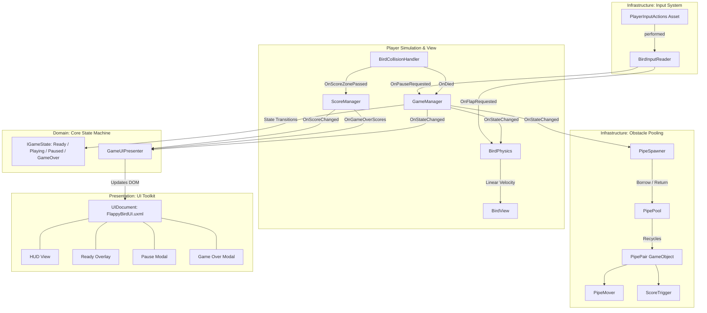

# SDD Proposal: 2D Flappy Bird Architecture & Implementation

## 1. Title & Intent

### 1.1 Problem Statement & Objectives
The objective of this initiative is to develop an ultra-responsive, deterministic, and arcade-authentic 2D **Flappy Bird** clone in **Unity 6 (6000.5.9f1)** utilizing modern Unity architectural standards:
- **Mockup-First Development**: Complete core mechanics, physics balance, and game loop using 2D geometric primitives (circles, boxes) and unlit materials, ensuring gameplay is proven before art integration.
- **SOLID Clean Architecture**: Decoupled, single-responsibility components with strict boundaries separating Domain logic, Simulation/Physics, and Presentation layers.
- **New Unity Input System (`com.unity.inputsystem`)**: Pure event-driven input handling supporting multi-platform control (Keyboard Space, Left Mouse Click, Touchscreen tap) with zero frame-by-frame polling.
- **UI Toolkit Flexbox Architecture**: Full replacement of legacy uGUI Canvas hierarchies with modern `UIDocument`, UXML documents, and USS flexbox stylesheets.
- **Strict Performance Discipline**: Zero GC heap allocations, zero `GetComponent<T>()` / `Find()` queries, and zero UI DOM traversals in hot lifecycle loops (`Update`, `FixedUpdate`).

---

## 2. Scope

### 2.1 In Scope
1. **Mockup Visuals & Scene Setup**:
   - Bird player entity (2D Circle primitive, Canary Yellow `#FFD700`).
   - Obstacle Pipe pairs with caps (2D Box primitives, Emerald Green `#2ECC71` / `#27AE60`).
   - Ground barrier & ceiling boundaries (2D Box primitive, Khaki Brown `#D35400`).
   - URP 2D Unlit / Flat visual presentation with camera framing (orthographic 9:16 portrait viewport).
2. **Physics & Movement Simulation**:
   - `Rigidbody2D` driven physics with continuous collision detection and Z-rotation constraint.
   - Deterministic jump impulse in `FixedUpdate` based on an atomic pending input flag.
   - Velocity clamping for terminal fall speed (prevents physics tunneling and guarantees recovery windows).
   - Procedural angular tilt (snappy upward pitch on flap, smooth dive on fall).
3. **New Unity Input System Integration**:
   - Dedicated `PlayerInputActions` asset with a "Gameplay" action map.
   - `Flap` action bound to `<Keyboard>/space`, `<Mouse>/leftButton`, and `<Touchscreen>/primaryTouch/tap`.
   - `Pause` action bound to `<Keyboard>/escape`.
   - Event-driven consumption (`InputAction.performed`) with zero polling in `Update()`.
4. **Object Pooling System**:
   - Pre-warmed object pool (`PipePool`) managing reusable `PipePair` instances via an `IPoolable` lifecycle contract.
   - Automatic gap position randomization and leftward scrolling (`PipeMover`).
   - Boundary-based recycling (zero runtime `Instantiate` or `Destroy` during gameplay).
5. **UI Toolkit Implementation**:
   - `UIDocument` driven by `FlappyBirdUI.uxml` and styled with `FlappyBirdUI.uss`.
   - Responsive flexbox screens:
     - **In-Game HUD**: Active run score counter and pause button.
     - **Ready Screen Overlay**: "Get Ready / Tap to Flap" prompt.
     - **Pause Menu Modal**: Semi-transparent backdrop with Resume, Restart, and Quit options.
     - **Game Over Modal**: Scoreboard with final run score, persistent best high score, new high score indicator, and restart action.
   - Configured `PanelSettings` asset supporting 9:16 reference resolution with screen size scaling.
6. **Core Game Loop & State Machine**:
   - Formal State Machine (`IGameState`): `ReadyState`, `PlayingState`, `PausedState`, `GameOverState`.
   - Centralized `GameManager` coordinating lifecycle transitions.
   - Score management (`ScoreManager`) tracking run score and persisting high score in `PlayerPrefs` exclusively on game over.
7. **Performance & GC Zero-Allocation Guarantees**:
   - One-time caching of all component references in `Awake()`.
   - UI Toolkit elements queried strictly once during `OnEnable()`.
   - Zero heap allocations (`new`, closures, boxing, LINQ, string concatenation) inside `Update()` and `FixedUpdate()`.

### 2.2 Out of Scope (Future Phases)
- Final production 2D sprites, spritesheets, parallax backgrounds, and frame-by-frame animations (mockup primitives used).
- Full audio engine integration, procedural audio, or sound effects/music playback (C# events will provide injection hooks).
- Online leaderboards, backend account syncing, or cloud save services.
- Microtransactions, ads, or monetization packages.

---

## 3. Approach & Architecture

### 3.1 Architectural Layering (Clean Architecture & SOLID)



#### Layer Responsibilities
1. **Domain Layer**:
   - `IGameState` interface and state definitions (`ReadyState`, `PlayingState`, `PausedState`, `GameOverState`).
   - `GameManager`: State transitions and lifecycle coordination.
   - `ScoreManager`: Score rules, high-score comparison, and persistence logic.
2. **Simulation / Infrastructure Layer**:
   - `BirdInputReader`: Adapts `com.unity.inputsystem` action callbacks into domain/player events.
   - `BirdPhysics`: Controls `Rigidbody2D` forces, velocity clamping, and angle calculations strictly in `FixedUpdate`.
   - `BirdCollisionHandler`: Filters layer-based collisions and dispatches game death/score events.
   - `PipePool` & `IPoolable`: Pre-allocated object pooling mechanism.
   - `PipeSpawner` & `PipeMover`: Kinematic obstacle positioning and translation.
3. **Presentation Layer**:
   - `BirdView`: Handles visual representation (procedural rotation or sprite changes) without touching physics logic.
   - `GameUIPresenter` (`UIController`): Decoupled UI Toolkit presenter. Listens to domain events (`OnStateChanged`, `OnScoreChanged`, `OnGameOverScores`) and updates the UXML DOM. Dispatches UI user actions (Resume, Restart, Quit) to `GameManager`.

---

### 3.2 Event-Driven Communication Contracts
To enforce Single Responsibility and Open-Closed principles, systems communicate via C# `event Action` contracts without direct tight coupling:

| Publisher | Event Contract | Subscriber(s) | Description |
| :--- | :--- | :--- | :--- |
| `BirdInputReader` | `event Action OnFlapRequested` | `BirdPhysics`, `GameManager` | Fired when Space/Click/Touch input occurs. In `ReadyState`, initiates game; in `PlayingState`, impulses bird. |
| `BirdInputReader` | `event Action OnPauseRequested` | `GameManager` | Fired when Escape is pressed. Toggles `PausedState`. |
| `BirdCollisionHandler` | `event Action OnDied` | `GameManager` | Fired when the bird collides with an obstacle or the ground. Transitions to `GameOverState`. |
| `ScoreTrigger` | `event Action OnScored` | `ScoreManager` | Fired when the bird passes through the gap collider. Increments score. |
| `GameManager` | `event Action<GameState> OnStateChanged` | `GameUIPresenter`, `PipeSpawner`, `BirdPhysics` | Notifies systems to enable/disable physics, spawning, and UI overlays. |
| `ScoreManager` | `event Action<int> OnScoreChanged` | `GameUIPresenter` | Notifies UI to update HUD score label. |
| `ScoreManager` | `event Action<int, int> OnGameOverScores` | `GameUIPresenter` | Delivers final score and high score to Game Over modal. |

---

### 3.3 UI Toolkit Presenter Pattern (`GameUIPresenter`)

#### Lifecycle & Query Policy:
- **`Awake()` / `OnEnable()`**:
  - Accesses `UIDocument.rootVisualElement`.
  - Performs one-time query and caching of all visual elements:
    ```csharp
    _hudContainer = root.Q<VisualElement>("hud-container");
    _hudScoreLabel = root.Q<Label>("hud-score");
    _btnPause = root.Q<Button>("btn-pause");
    _panelReady = root.Q<VisualElement>("panel-ready");
    _panelPause = root.Q<VisualElement>("panel-pause");
    _panelGameOver = root.Q<VisualElement>("panel-gameover");
    _lblFinalScore = root.Q<Label>("lbl-final-score");
    _lblHighScore = root.Q<Label>("lbl-high-score");
    _btnRestart = root.Q<Button>("btn-restart");
    _btnResume = root.Q<Button>("btn-resume");
    _btnRestartPause = root.Q<Button>("btn-restart-pause");
    _btnQuit = root.Q<Button>("btn-quit");
    ```
  - Binds UI click callbacks (`clicked += ...`).
  - Subscribes to `GameManager` and `ScoreManager` events.
- **`OnDisable()`**:
  - Unregisters all UI click callbacks and unhooks event subscriptions.
- **Hot Loop Guarantee**:
  - Zero calls to `Q<T>()` or `Query<T>()` in `Update()`.
  - Panel visibility transitions handled cleanly via USS utility classes or `style.display = DisplayStyle.Flex / DisplayStyle.None`.

---

### 3.4 Object Pooling Architecture (`PipePool`)
- **Pool Size**: Pre-warms 6 to 8 `PipePair` instances at scene initialization.
- **Lifecycle Interface**:
  ```csharp
  public interface IPoolable
  {
      void OnSpawn();
      void OnDespawn();
  }
  ```
- **Reusability**:
  - When a pipe reaches `despawnX` ($\approx -10.0$ units), `PipeMover` returns the composite `PipePair` to `PipePool`.
  - `OnDespawn()` deactivates the GameObject and clears internal state.
  - `OnSpawn()` re-enables the `ScoreTrigger` collider, resets position, and randomizes the vertical gap center.
  - Restarting the game reclaims all active instances without destroying and recreating them.

---

## 4. Impact & Blast Radius

### 4.1 Project Assets to Create

```
Assets/
├── Prefabs/
│   ├── Bird.prefab                     # Player GameObject with Rigidbody2D, CircleCollider2D, Bird scripts
│   ├── PipePair.prefab                 # Obstacle composite (Top/Bottom pipes, ScoreTrigger, PipeMover)
│   └── GameManager.prefab              # Core manager holder (GameManager, ScoreManager, Spawner, Pool)
├── Scripts/
│   ├── Core/
│   │   ├── IGameState.cs               # State interface (Enter, Update, FixedUpdate, Exit)
│   │   ├── GameState.cs                # Enum: Ready, Playing, Paused, GameOver
│   │   ├── GameManager.cs              # State machine coordinator & event dispatcher
│   │   ├── ScoreManager.cs             # Run score tracker & high score persistence
│   │   └── States/
│   │       ├── ReadyState.cs           # Suspended bird, waits for first flap
│   │       ├── PlayingState.cs         # Active simulation, spawning, scoring
│   │       ├── PausedState.cs          # Time-freeze, pause menu
│   │       └── GameOverState.cs        # Motion halt, score calculation, modal display
│   ├── Player/
│   │   ├── BirdInputReader.cs          # New Input System event subscriber (zero polling)
│   │   ├── BirdPhysics.cs              # Rigidbody2D jump impulse, velocity clamping, tilt
│   │   ├── BirdCollisionHandler.cs     # Layer-filtered collision & trigger detection
│   │   └── BirdView.cs                 # Presentation decoupling (rotation/sprite updates)
│   ├── Obstacles/
│   │   ├── IPoolable.cs                # Object pool contract
│   │   ├── PipePool.cs                 # Pre-allocated zero-GC pool
│   │   ├── PipePair.cs                 # Composite obstacle controller
│   │   ├── PipeMover.cs                # Leftward translation & despawn detection
│   │   ├── PipeSpawner.cs              # Spawn timer & randomized gap positioning
│   │   └── ScoreTrigger.cs             # Single-entry score zone
│   └── UI/
│       ├── GameUIPresenter.cs          # UI Toolkit presenter & event subscriber
│       └── IntToStringLookup.cs        # (Optional) Pre-cached string lookup for 0-999 to eliminate GC
├── Settings/
│   └── Input/
│       └── PlayerInputActions.inputactions # Input Action Asset (Gameplay: Flap, Pause)
└── UI/
    ├── FlappyBirdUI.uxml               # Semantic UXML document (HUD, Ready, Pause, GameOver)
    ├── FlappyBirdUI.uss                # Responsive USS stylesheet (Flexbox layouts)
    └── FlappyBirdPanelSettings.asset   # UI Toolkit PanelSettings (Scale With Screen Size: 1080x1920)
```

### 4.2 Scene Modifications
- **`Assets/Scenes/SampleScene.unity`**:
  - Orthographic 2D Camera configured with unlit sky background color (`#70C5CE`), orthographic size $5.0$.
  - Ground boundary positioned at $Y \approx -4.5$ with `BoxCollider2D`.
  - Ceiling boundary positioned at $Y \approx +5.5$ with `BoxCollider2D`.
  - `UIDocument` GameObject referencing `FlappyBirdPanelSettings.asset`, `FlappyBirdUI.uxml`, and `GameUIPresenter`.
  - `GameManager` GameObject with `GameManager`, `ScoreManager`, `PipePool`, `PipeSpawner`.
  - `Bird` prefab instance positioned at $X = -1.5, Y = 0.0$.

### 4.3 Blast Radius & Dependencies
- **Isolated Module**: All new classes reside in dedicated namespaces (`FlappyBird.Core`, `FlappyBird.Player`, `FlappyBird.Obstacles`, `FlappyBird.UI`).
- **No Existing Code Overrides**: Clean additive implementation; zero legacy code conflicts.
- **Package Dependencies**:
  - `com.unity.inputsystem`: Must be active in `ProjectSettings/Player` ("Active Input Handling").
  - `com.unity.modules.ui`: UI Toolkit built-in modules (`UIDocument`, `PanelSettings`).
  - `com.unity.render-pipelines.universal`: URP 2D forward renderer.

---

## 5. Verification Strategy & Acceptance Criteria

### 5.1 Verification Checklist

| Phase | Test Case | Expected Outcome |
| :--- | :--- | :--- |
| **Compilation** | Script compilation in Unity 6 | Clean compilation with zero warnings or errors. |
| **Input Handling** | Press Space, Left Click, or Touch tap | Event triggers `OnFlapRequested`. Bird jumps with immediate upward impulse. |
| **Physics Clamping** | Allow bird to free-fall from top of screen | Downward velocity strictly capped at `maxFallSpeed` (e.g. $-10.5\,\text{m/s}$). No physics tunneling through ground. |
| **Procedural Rotation** | Flap then fall | Bird rotates to $+25^\circ \sim +30^\circ$ on jump, dives smoothly to $-90^\circ$ as vertical speed decreases. |
| **Obstacle Flow** | Play for $\ge 30$ seconds | Pipes spawn at steady cadence ($\approx 1.6\,\text{s}$), scroll smoothly left, despawn past $-10.0$, and recycle via `PipePool` without new allocations. |
| **Scoring** | Navigate through pipe gap | Score increments by exactly $1$ per pipe pair. HUD label updates instantly. |
| **Collision** | Collide with pipe or ground | Game immediately halts pipe translation, disables flap input, persists high score if beaten, and displays Game Over modal. |
| **UI State Flow** | Ready $\to$ Playing $\to$ Pause $\to$ Resume $\to$ Game Over $\to$ Restart | All UI Toolkit overlays display and dismiss accurately according to state machine transitions. |
| **Resolution Scaling**| Switch Game view between 9:16 Portrait, 16:9 Landscape, and Free Aspect | UI Toolkit flexbox elements scale correctly via `PanelSettings` without clipping or overflow. |
| **GC Allocation** | Profile active gameplay loop via Unity Profiler | Steady-state GC allocation in `Update()` and `FixedUpdate()` is strictly **0 Bytes**. |

---

## 6. Risks & Mitigation

| Risk | Likelihood | Impact | Architectural Mitigation |
| :--- | :---: | :---: | :--- |
| **Unity Input System Inactive** | Low | High | Ensure `ProjectSettings/Player` has "Active Input Handling" set to `Both` or `Input System Package (New)`. Verify during initial setup. |
| **Input Latency vs. Physics Lag** | Medium | High | Asynchronous `InputAction.performed` events set an atomic `_isFlapPending` flag consumed directly in `FixedUpdate()`. Rigidbody2D `Interpolate` mode enabled to ensure silky-smooth rendering. |
| **UI Toolkit Display Glitches on Mobile/Desktop Aspect Ratios** | Medium | Medium | Use `PanelSettings` configured for `Scale With Screen Size` (Reference: $1080 \times 1920$, Match: $0.5$ or Width). Use percentage and flexbox constraints (`flex-grow`, `align-items: center`, `justify-content: center`) in USS. |
| **Multiple Score Triggers from Single Gap** | Low | Medium | `ScoreTrigger` disables its `Collider2D` immediately upon first trigger contact and re-enables it only on `IPoolable.OnSpawn()`. |
| **Garbage Collection Hitching on Score Update** | Medium | Medium | Avoid continuous string concatenation in `Update()`. Update score label text only on `OnScoreChanged(int)` event. Optionally use a static array of pre-allocated string numbers (`0` through `999`). |
| **Pool Starvation on Fast Respawns** | Low | Medium | Size the `PipePool` to at least $8$ instances (maximum on-screen simultaneous pipes is $\approx 3 \sim 4$). Reset and return all active pipes to pool upon entering `ReadyState`. |

---

## 7. Next Steps & Recommendation

With this proposal approved:
1. Proceed to **`sdd-spec`** to specify exact C# interfaces, class contracts, field types, and UXML element hierarchies.
2. Proceed to **`sdd-design`** for sequence diagrams, state transitions, and memory allocation audits.
3. Advance through **`sdd-tasks`** to generate atomic implementation steps.
