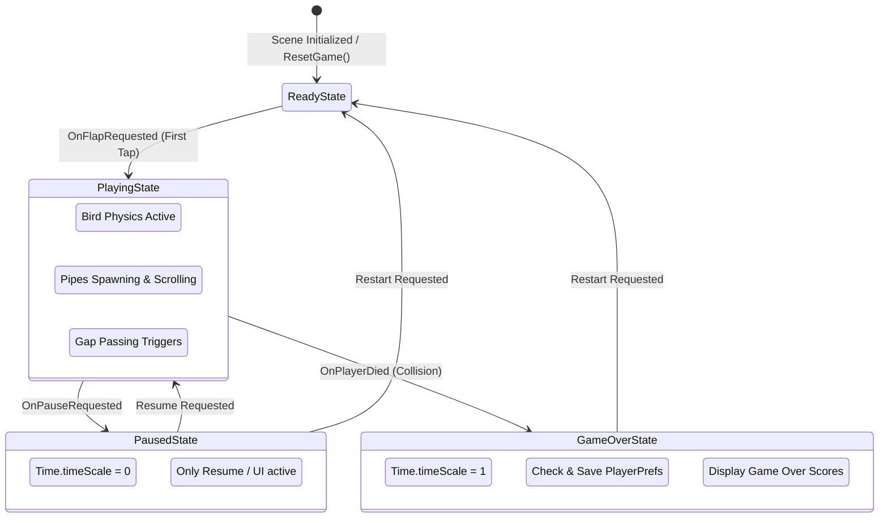
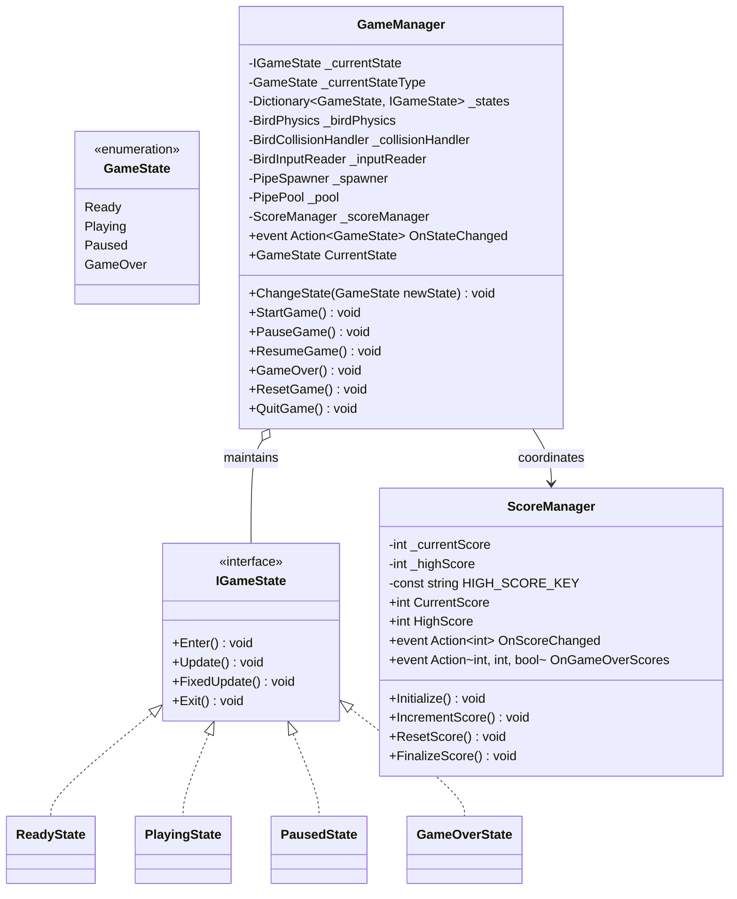

# Domain Delta Specification: Gameplay & Core Game Loop

## 1. Document Overview
- **Domain**: `FlappyBird.Core`
- **Related Requirements**: Finite State Machine (`IGameState`), event orchestration, run score tracking, persistent high score with `PlayerPrefs`, `Time.timeScale` pause handling, non-destructive game restart.
- **RFC 2119 Keywords**: MUST, MUST NOT, SHALL, SHALL NOT, SHOULD, SHOULD NOT, RECOMMENDED, MAY.

---

## 2. Architectural Boundaries & Component Roles





---

## 3. Normative Requirements (RFC 2119)

### 3.1 State Machine Lifecycle & Transitions (`IGameState`, `GameManager`)
1. All game states MUST implement the `IGameState` interface:
   - `Enter()`: Invoked upon transitioning into the state.
   - `Update()`: Invoked every frame during `MonoBehaviour.Update()`.
   - `FixedUpdate()`: Invoked every fixed physics step during `MonoBehaviour.FixedUpdate()`.
   - `Exit()`: Invoked immediately before leaving the state.
2. `GameManager` MUST instantiate or configure four concrete states:
   - `ReadyState`
   - `PlayingState`
   - `PausedState`
   - `GameOverState`
3. Upon scene load, `GameManager` MUST immediately enter `ReadyState`.
4. State transition rules MUST be strictly enforced:
   - From `ReadyState`: Valid transition ONLY to `PlayingState` (on first flap input).
   - From `PlayingState`: Valid transitions to `PausedState` (pause request) or `GameOverState` (player death).
   - From `PausedState`: Valid transitions to `PlayingState` (resume) or `ReadyState` (restart).
   - From `GameOverState`: Valid transition ONLY to `ReadyState` (restart).
5. Whenever a state change occurs, `GameManager` MUST:
   - Call `Exit()` on the active state.
   - Update `_currentStateType`.
   - Call `Enter()` on the new state.
   - Invoke `OnStateChanged(newState)` to inform external subscribers (UI, Spawner, Audio).

### 3.2 State Behaviors

#### ReadyState:
1. In `ReadyState`:
   - `Time.timeScale` MUST be set to `1.0f`.
   - `BirdPhysics` MUST set `Rigidbody2D.simulated = false` (or freeze motion at starting position $(-1.5, 0.0)$).
   - `PipeSpawner` MUST be disabled.
   - `PipePool` MUST reclaim all active pipes via `ResetAll()`.
   - `ScoreManager` MUST call `ResetScore()`.
2. When `BirdInputReader.OnFlapRequested` fires while in `ReadyState`, `GameManager` MUST transition directly to `PlayingState`.

#### PlayingState:
1. In `PlayingState`:
   - `Time.timeScale` MUST be `1.0f`.
   - `BirdPhysics` MUST set `Rigidbody2D.simulated = true` and process the initial flap impulse.
   - `PipeSpawner` MUST start countdown and spawning.
   - `ScoreTrigger.OnScored` MUST increment the active run score.
2. If `BirdCollisionHandler.OnDied` fires while in `PlayingState`, `GameManager` MUST transition to `GameOverState`.
3. If `BirdInputReader.OnPauseRequested` fires while in `PlayingState`, `GameManager` MUST transition to `PausedState`.

#### PausedState:
1. In `PausedState`:
   - `GameManager` MUST set `Time.timeScale = 0.0f`.
   - Physics simulation and spawner timers MUST halt naturally due to zero timescale.
   - `BirdInputReader.OnPauseRequested` MAY toggle unpausing back to `PlayingState`.
2. When exiting `PausedState`, `GameManager` MUST restore `Time.timeScale = 1.0f`.

#### GameOverState:
1. In `GameOverState`:
   - `Time.timeScale` MUST remain `1.0f` to allow post-death effects, animations, or UI transitions.
   - `BirdPhysics` MUST disable further flap inputs.
   - `PipeMover` instances MUST stop translation.
   - `PipeSpawner` MUST stop spawning.
   - `ScoreManager.FinalizeScore()` MUST be invoked.

### 3.3 Scoring & High Score Persistence (`ScoreManager`)
1. `ScoreManager` MUST load the high score from `PlayerPrefs.GetInt(HIGH_SCORE_KEY, 0)` during initialization.
2. The key used for persistence MUST be `"FlappyBird_HighScore"`.
3. When `IncrementScore()` is called (via `ScoreTrigger.OnScored`):
   - `_currentScore` SHALL increase by exactly $1$.
   - `ScoreManager` MUST invoke `OnScoreChanged(_currentScore)`.
4. When `ResetScore()` is called:
   - `_currentScore` MUST be reset to $0$.
   - `ScoreManager` MUST invoke `OnScoreChanged(0)`.
5. When `FinalizeScore()` is called upon game over:
   - If `_currentScore > _highScore`:
     - `_highScore` MUST be set to `_currentScore`.
     - `PlayerPrefs.SetInt(HIGH_SCORE_KEY, _highScore)` MUST be written.
     - `PlayerPrefs.Save()` MUST be called.
     - A boolean `isNewBest` flag MUST be evaluated as `true`.
   - Else:
     - `isNewBest` MUST be evaluated as `false`.
   - `ScoreManager` MUST invoke `OnGameOverScores(_currentScore, _highScore, isNewBest)`.

### 3.4 Game Reset Without Scene Reloading
1. `GameManager.ResetGame()` MUST NOT call `SceneManager.LoadScene()`.
2. `ResetGame()` MUST:
   - Transition to `ReadyState`.
   - Reposition the Bird entity to initial coordinates $(-1.5, 0.0)$.
   - Reset the bird's velocity and angular rotation.
   - Reset `BirdCollisionHandler` death flag.
   - Clear all active obstacles via `PipePool.ResetAll()`.
   - Reset `ScoreManager`.

---

## 4. BDD Behavioral Scenarios

### Feature: State Machine Progression & Score Persistence

```gherkin
Scenario: Game initializes in ReadyState
  Given the Flappy Bird scene is loaded
  When GameManager executes Awake and Start
  Then the current state is ReadyState
    And Bird physics simulation is suspended at (-1.5, 0.0)
    And PipeSpawner is inactive
    And CurrentScore is 0
    And HighScore is loaded from PlayerPrefs
```

```gherkin
Scenario: First tap transitions Ready to Playing
  Given the game is in ReadyState
  When the player executes the Flap input
  Then GameManager transitions from ReadyState to PlayingState
    And OnStateChanged(GameState.Playing) is broadcast
    And Bird physics simulation becomes active
    And the initial flap impulse is applied
    And PipeSpawner begins its countdown
```

```gherkin
Scenario: Player pauses the active game
  Given the game is in PlayingState with pipes scrolling
  When BirdInputReader receives the Pause action (Escape key)
  Then GameManager transitions to PausedState
    And Time.timeScale is set to 0.0
    And pipe movement and spawner timers freeze
    And OnStateChanged(GameState.Paused) is broadcast
  When the player triggers Resume via UI or Escape
  Then GameManager transitions back to PlayingState
    And Time.timeScale is restored to 1.0
    And pipe movement resumes seamlessly
```

```gherkin
Scenario: Bird collision triggers Game Over and records New High Score
  Given the game is in PlayingState
    And the stored HighScore is 5
    And the CurrentScore reaches 8
  When the bird collides with an obstacle pipe
  Then BirdCollisionHandler invokes OnDied
    And GameManager transitions to GameOverState
    And ScoreManager detects CurrentScore (8) > HighScore (5)
    And HighScore is updated to 8
    And PlayerPrefs persists 8 under "FlappyBird_HighScore"
    And ScoreManager dispatches OnGameOverScores(8, 8, true)
    And OnStateChanged(GameState.GameOver) is broadcast
```

```gherkin
Scenario: Non-destructive game restart
  Given the game is in GameOverState
    And 2 pipes remain visible in the scene
    And final score was 8
  When the player clicks the Restart button
  Then GameManager invokes ResetGame()
    And PipePool recycles the 2 visible pipes back to inactive pool
    And the bird is repositioned to (-1.5, 0.0) with zero velocity
    And CurrentScore is reset to 0
    And the state transitions to ReadyState
    And no scene reload occurs
```
