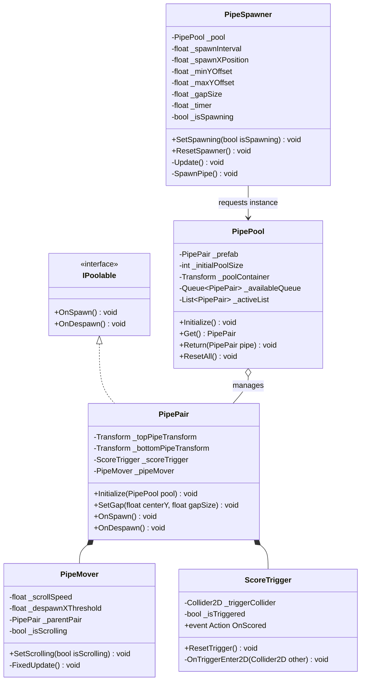

# Domain Delta Specification: Obstacles & Object Pooling

## 1. Document Overview
- **Domain**: `FlappyBird.Obstacles`
- **Related Requirements**: Zero-allocation object pooling (`IPoolable`), continuous horizontal scroll in `FixedUpdate`, boundary recycling, vertical gap height randomization, one-shot score triggers.
- **RFC 2119 Keywords**: MUST, MUST NOT, SHALL, SHALL NOT, SHOULD, SHOULD NOT, RECOMMENDED, MAY.

---

## 2. Architectural Boundaries & Component Roles



---

## 3. Normative Requirements (RFC 2119)

### 3.1 Object Pooling System (`IPoolable`, `PipePool`)
1. All obstacle instances MUST implement the `IPoolable` interface contract:
   - `OnSpawn()`: Prepares the GameObject for active gameplay, enables colliders, and activates visual elements.
   - `OnDespawn()`: Clears active flags, deactivates the GameObject, and silences child components.
2. `PipePool` MUST pre-warm the pool during initialization (`Awake()` or explicit startup) by instantiating at least $6$ (RECOMMENDED: $8$) `PipePair` instances.
3. `PipePool` MUST NOT call `Object.Instantiate()` or `Object.Destroy()` during active gameplay loops.
4. If `PipePool.Get()` is called and the pool is empty, it MAY instantiate an emergency instance while logging a warning, but the configured pool size SHOULD guarantee no exhaustion during normal gameplay.
5. When `PipePool.Return(PipePair)` is called:
   - The instance's `OnDespawn()` MUST be called.
   - The instance MUST be returned to the pool's inactive collection.
   - The instance's `GameObject.SetActive(false)` MUST be verified.
6. `PipePool.ResetAll()` MUST reclaim all currently active `PipePair` instances and return them to the inactive pool.

### 3.2 Obstacle Movement & Recycling (`PipeMover`)
1. `PipeMover` MUST translate the `PipePair` leftward along the X-axis exclusively during `FixedUpdate()`:
   - $\Delta X = -\text{scrollSpeed} \times \text{Time.fixedDeltaTime}$.
2. `PipeMover` MUST cease horizontal translation immediately when the game state is not `PlayingState` (e.g. `PausedState` or `GameOverState`).
3. `PipeMover` MUST evaluate its horizontal position against `despawnXThreshold` (e.g., $-10.0\,\text{m}$ in world space).
4. As soon as `transform.position.x <= despawnXThreshold`:
   - `PipeMover` SHALL notify the parent `PipePair` or directly invoke `PipePool.Return(parentPair)`.
   - The `PipePair` MUST NOT remain active beyond the threshold.

### 3.3 Spawner & Vertical Gap Randomization (`PipeSpawner`)
1. `PipeSpawner` SHALL maintain a spawn countdown timer initialized to `spawnInterval` (e.g., $1.6\,\text{s}$).
2. The spawner MUST only advance the timer while in `PlayingState`.
3. When the countdown timer reaches or drops below zero:
   - `PipeSpawner` SHALL retrieve a `PipePair` from `PipePool`.
   - A random vertical offset $Y_{\text{center}}$ MUST be chosen between `minYOffset` (e.g. $-1.5\,\text{m}$) and `maxYOffset` (e.g. $+2.0\,\text{m}$).
   - The `PipePair` MUST be placed at world coordinate $(X_{\text{spawn}}, Y_{\text{center}}, 0)$.
   - The top and bottom pipe segments MUST be positioned symmetrically relative to $Y_{\text{center}}$ according to `gapSize` (e.g., $3.2\,\text{m}$).
   - The spawn timer MUST be reset to `spawnInterval`.
4. `PipeSpawner.ResetSpawner()` MUST reset the timer to initial countdown and cease spawning until re-enabled.

### 3.4 Score Trigger Pass Detection (`ScoreTrigger`)
1. The `ScoreTrigger` GameObject MUST have a `BoxCollider2D` with `isTrigger = true` positioned precisely within the gap between the top and bottom pipes.
2. `ScoreTrigger` MUST listen to `OnTriggerEnter2D(Collider2D other)`.
3. When a collider matching the Player layer/tag enters the trigger zone:
   - If `_isTriggered` is `false`, `ScoreTrigger` MUST set `_isTriggered = true` and invoke `OnScored`.
   - `ScoreTrigger` MUST immediately set its `Collider2D.enabled = false` to guarantee one-shot dispatch.
4. `ScoreTrigger.ResetTrigger()` (called inside `PipePair.OnSpawn()`) MUST reset `_isTriggered = false` and re-enable `Collider2D.enabled = true`.

### 3.5 Allocation Constraints
1. The obstacle subsystem MUST NOT invoke LINQ methods, string formatting, or instantiate new collections during `FixedUpdate()` or `Update()`.
2. All collection buffers (`_availableQueue`, `_activeList`) MUST be pre-allocated with fixed capacity.

---

## 4. BDD Behavioral Scenarios

### Feature: Pre-warmed Object Pooling & Lifecycle

```gherkin
Scenario: Pool pre-warms without runtime instantiate
  Given the scene initializes with PipePool configured to size 8
  When Awake completes
  Then exactly 8 PipePair instances exist under the pool container
    And all 8 instances are inactive in the hierarchy
    And zero active pipes exist in the active list
```

```gherkin
Scenario: Spawning a pipe from the pool
  Given the PipePool contains 8 inactive pipe instances
    And the game transitions to PlayingState
  When the spawn timer of 1.6 seconds elapses
  Then PipeSpawner requests an instance via PipePool.Get()
    And PipePair.OnSpawn() is invoked
    And the pipe GameObject becomes active at X = +10.0
    And the vertical gap center Y is randomized between -1.5 and +2.0
    And the ScoreTrigger collider is enabled and primed
    And remaining inactive pipes in pool is 7
```

```gherkin
Scenario: Pipe reaches left despawn threshold
  Given an active PipePair is scrolling left
    And its world X position reaches -10.05 m
    And despawnXThreshold is -10.0 m
  When PipeMover evaluates position in FixedUpdate
  Then PipeMover triggers pool return
    And PipePair.OnDespawn() is invoked
    And the pipe GameObject is deactivated
    And the instance is returned to PipePool available queue
    And active list count decreases by 1
```

```gherkin
Scenario: One-shot score trigger passing
  Given an active PipePair with ScoreTrigger enabled
    And _isTriggered is false
  When the player bird passes through the gap and touches the ScoreTrigger
  Then OnTriggerEnter2D is invoked
    And ScoreTrigger fires OnScored
    And _isTriggered becomes true
    And the BoxCollider2D on ScoreTrigger is immediately disabled
  When the bird remains inside or re-contacts the trigger zone in subsequent frames
  Then OnScored is not dispatched again
```

```gherkin
Scenario: Game restart recycles all active pipes
  Given 3 PipePair instances are actively scrolling across the screen
  When the game resets to ReadyState
  Then PipePool.ResetAll() is executed
    And all 3 active instances have OnDespawn() invoked
    And all 3 instances become inactive
    And PipePool available queue count returns to initial size of 8
    And zero runtime Garbage Collection allocations occur
```
