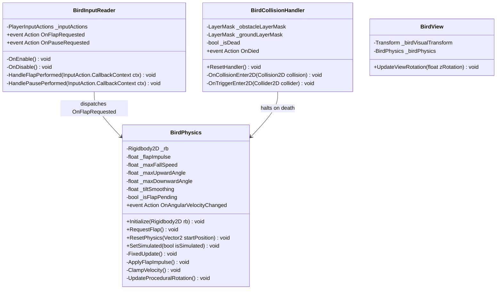

# Domain Delta Specification: Player

## 1. Document Overview
- **Domain**: `FlappyBird.Player`
- **Related Requirements**: New Input System event pipeline, Rigidbody2D simulation, deterministic upward impulse, velocity clamping, continuous collision detection, zero-allocation hot loops.
- **RFC 2119 Keywords**: MUST, MUST NOT, SHALL, SHALL NOT, SHOULD, SHOULD NOT, RECOMMENDED, MAY.

---

## 2. Architectural Boundaries & Component Roles



---

## 3. Normative Requirements (RFC 2119)

### 3.1 Input Reception & Dispatch
1. `BirdInputReader` SHALL subscribe to the New Input System `InputAction.performed` events on the `Gameplay/Flap` and `Gameplay/Pause` actions during `OnEnable()`.
2. `BirdInputReader` MUST unhook all `performed` event listeners during `OnDisable()` to prevent memory leaks and dangling delegates.
3. `BirdInputReader` MUST NOT invoke `InputAction.ReadValue<T>()` or poll `wasPressedThisFrame` within `Update()`.
4. When `Flap` is performed, `BirdInputReader` SHALL immediately invoke `OnFlapRequested`.
5. When `Pause` is performed, `BirdInputReader` SHALL immediately invoke `OnPauseRequested`.

### 3.2 Physics Simulation & Atomic Handoff
1. `BirdPhysics` MUST maintain a boolean flag `_isFlapPending`.
2. When `RequestFlap()` is invoked (via `OnFlapRequested`), `_isFlapPending` SHALL be set to `true`.
3. `BirdPhysics` MUST perform all force, impulse, and velocity modifications exclusively inside `FixedUpdate()`.
4. If `_isFlapPending` is `true` during `FixedUpdate()`:
   - `BirdPhysics` MUST reset the Y component of `Rigidbody2D.linearVelocity` (or `velocity`) to zero before applying impulse.
   - `BirdPhysics` SHALL apply an upward impulse of magnitude `flapImpulse` (e.g., $7.5\,\text{m/s}$).
   - `BirdPhysics` MUST set `_isFlapPending` to `false` within the same physics step.
5. If multiple flap inputs occur within a single fixed physics frame, they MUST be coalesced into a single flap impulse without compounding velocity.
6. `BirdPhysics` MUST clamp `linearVelocity.y` such that it SHALL NOT fall below `-maxFallSpeed` (e.g., $-10.5\,\text{m/s}$).
7. The `Rigidbody2D` on the Bird entity MUST be configured with:
   - `collisionDetectionMode = CollisionDetectionMode2D.Continuous`
   - `interpolation = RigidbodyInterpolation2D.Interpolate`
   - `constraints = RigidbodyConstraints2D.FreezeRotation` (Z-rotation controlled procedurally)
8. `BirdPhysics` SHOULD interpolate transform rotation or pass angular state to `BirdView` smoothly:
   - Snapping upward to $+25^\circ \sim +30^\circ$ immediately upon flap.
   - Smoothly diving toward $-90^\circ$ (nose dive) as downward velocity approaches `-maxFallSpeed`.

### 3.3 Collision Detection & Safety
1. `BirdCollisionHandler` MUST listen to `OnCollisionEnter2D(Collision2D collision)`.
2. `BirdCollisionHandler` SHALL filter collisions using layer bitmasks or cached component tags (`Obstacle`, `Ground`).
3. Upon first qualifying contact with an obstacle or ground boundary, `BirdCollisionHandler` MUST fire `OnDied` and set `_isDead = true`.
4. Any subsequent collision calls while `_isDead == true` MUST be ignored immediately.
5. `BirdCollisionHandler` MUST reset `_isDead = false` when `ResetHandler()` is explicitly invoked by `GameManager`.

### 3.4 Allocation & Performance Constraints
1. The Player subsystem MUST NOT execute `GetComponent<T>()`, `GetComponentInChildren<T>()`, or `GameObject.Find*()` inside `Update()` or `FixedUpdate()`.
2. All component references SHALL be cached during `Awake()` or injected via serialized fields.
3. The hot lifecycle methods (`Update`, `FixedUpdate`, `OnCollisionEnter2D`) MUST produce strictly **0 Bytes** of managed heap memory allocation per frame in the steady state.

---

## 4. BDD Behavioral Scenarios

### Feature: Deterministic Flap Physics

```gherkin
Scenario: Player presses Flap during normal fall
  Given the bird entity is in PlayingState
    And the bird has a downward velocity of -6.0 m/s
    And _isFlapPending is false
  When the player performs the Flap action via Keyboard Space
  Then BirdInputReader dispatches OnFlapRequested
    And BirdPhysics sets _isFlapPending to true
  When the next FixedUpdate runs
  Then the bird's vertical velocity is reset to 0 m/s
    And an upward impulse of +7.5 m/s is applied
    And _isFlapPending is reset to false
    And the bird begins climbing
```

```gherkin
Scenario: Rapid multiple Flap inputs within a single physics timestep
  Given the bird is falling
    And the current time is between FixedUpdate ticks
  When the player presses Space
    And the player taps the screen within 2 milliseconds
  Then BirdInputReader dispatches OnFlapRequested twice
    And _isFlapPending remains true
  When FixedUpdate executes
  Then exactly one upward impulse of +7.5 m/s is applied
    And no double-impulse occurs
```

```gherkin
Scenario: Terminal fall velocity clamping
  Given the bird is falling freely without player input
    And the current downward velocity is -10.4 m/s
    And maxFallSpeed is configured as 10.5 m/s
  When gravity accelerates the bird downwards over delta time
  Then FixedUpdate clamps the vertical velocity
    And the vertical velocity does not exceed -10.5 m/s
    And physics tunneling through the ground collider is prevented
```

```gherkin
Scenario: Collision with obstacle pipe
  Given the bird is navigating through a pipe gap
    And _isDead is false
  When the bird's CircleCollider2D contacts the pipe's BoxCollider2D
  Then OnCollisionEnter2D is invoked
    And the layer matches the Obstacle layer mask
    And BirdCollisionHandler invokes OnDied
    And _isDead transitions to true
    And any subsequent collision events in the same frame are ignored
```

```gherkin
Scenario: Game reset restores physics state
  Given the bird has collided and is dead at position (2.5, -4.0)
  When GameManager resets the game to ReadyState
  Then BirdPhysics.ResetPhysics(startPosition) is called
    And the bird transform is moved to (-1.5, 0.0)
    And Rigidbody2D velocity is set to Vector2.zero
    And Rigidbody2D.simulated is set to false (or gravity is suspended)
    And BirdCollisionHandler.ResetHandler() sets _isDead to false
```
