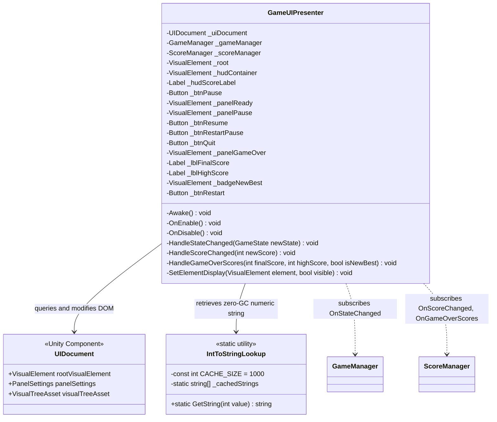

# Domain Delta Specification: UI Toolkit Presentation

## 1. Document Overview
- **Domain**: `FlappyBird.UI`
- **Related Requirements**: UI Toolkit flexbox architecture, `UIDocument`, responsive `PanelSettings` ($1080 \times 1920$, Scale With Screen Size), reactive `GameUIPresenter`, zero-allocation element caching, state overlay visibility management.
- **RFC 2119 Keywords**: MUST, MUST NOT, SHALL, SHALL NOT, SHOULD, SHOULD NOT, RECOMMENDED, MAY.

---

## 2. Architectural Boundaries & Component Roles



---

## 3. Normative Requirements (RFC 2119)

### 3.1 Visual Structure & UXML Elements (`FlappyBirdUI.uxml`)
1. The UI MUST be authored in a single semantic UXML document: `Assets/UI/FlappyBirdUI.uxml`.
2. The root container MUST have class `root-container` and fill $100\%$ of width and height with absolute positioning.
3. The UXML hierarchy MUST contain the following named visual elements:
   - `#hud-container`: Positioned at the top of the viewport.
     - `#hud-score`: `Label` displaying the active run score centered horizontally.
     - `#btn-pause`: `Button` placed at the top-right corner to trigger pause.
   - `#panel-ready`: Centered overlay displayed during `ReadyState`.
     - `#lbl-ready-title`: `Label` ("GET READY").
     - `#lbl-ready-hint`: `Label` ("TAP TO FLAP").
   - `#panel-pause`: Full-screen modal overlay with semi-transparent backdrop.
     - `#lbl-pause-title`: `Label` ("PAUSED").
     - `#btn-resume`: `Button` ("RESUME").
     - `#btn-restart-pause`: `Button` ("RESTART").
     - `#btn-quit`: `Button` ("QUIT").
   - `#panel-gameover`: Full-screen modal overlay with semi-transparent backdrop.
     - `#lbl-gameover-title`: `Label` ("GAME OVER").
     - `#box-scoreboard`: Container for scores.
       - `#lbl-final-score-title`: `Label` ("SCORE").
       - `#lbl-final-score`: `Label` (e.g. "0").
       - `#lbl-high-score-title`: `Label` ("BEST").
       - `#lbl-high-score`: `Label` (e.g. "0").
       - `#badge-new-best`: `VisualElement` or `Label` indicating a new record.
     - `#btn-restart`: `Button` ("PLAY AGAIN").

### 3.2 Responsive Sizing & PanelSettings (`FlappyBirdPanelSettings.asset`)
1. The UI Toolkit presentation MUST use a dedicated `PanelSettings` asset located at `Assets/UI/FlappyBirdPanelSettings.asset`.
2. `PanelSettings` MUST be configured with:
   - `Scale Mode`: `Scale With Screen Size`.
   - `Reference Resolution`: $1080 \times 1920$ (9:16 portrait standard).
   - `Screen Match Mode`: `Match Width Or Height`.
   - `Match`: $0.5$ (or $0.0$ for fixed width matching).
3. The USS stylesheet (`Assets/UI/FlappyBirdUI.uss`) MUST use flexbox layout rules (`flex-direction: column`, `align-items: center`, `justify-content: center`) and relative units (`%`, `px`) to prevent visual clipping across varied aspect ratios.
4. Interactive buttons MUST provide a minimum touch target area of $64 \times 64\,\text{px}$ in the reference canvas scale.

### 3.3 Reactive UI Presenter (`GameUIPresenter`)
1. `GameUIPresenter` MUST query and cache all visual element references during `Awake()` or `OnEnable()`.
2. `GameUIPresenter` MUST NOT invoke `root.Q<T>()` or `root.Query<T>()` inside `Update()`, `FixedUpdate()`, or inside event callbacks.
3. In `OnEnable()`, `GameUIPresenter` MUST:
   - Register button click callbacks (`clicked += ...`) for `#btn-pause`, `#btn-resume`, `#btn-restart-pause`, `#btn-quit`, and `#btn-restart`.
   - Subscribe to `GameManager.OnStateChanged`.
   - Subscribe to `ScoreManager.OnScoreChanged`.
   - Subscribe to `ScoreManager.OnGameOverScores`.
4. In `OnDisable()`, `GameUIPresenter` MUST:
   - Unregister all button click callbacks.
   - Unsubscribe from all `GameManager` and `ScoreManager` events.
5. Visibility of UI panels MUST be toggled using `VisualElement.style.display`:
   - Visible: `DisplayStyle.Flex`.
   - Hidden: `DisplayStyle.None`.
   - Classes or direct style properties MAY be used, but `display: none` MUST be used so hidden panels do not consume layout space or receive touch raycasts.

### 3.4 State-Driven Visibility Contract
Upon receiving `GameManager.OnStateChanged(GameState newState)`:
1. When `newState == GameState.Ready`:
   - `#panel-ready.style.display` MUST be `DisplayStyle.Flex`.
   - `#hud-container.style.display` MUST be `DisplayStyle.None`.
   - `#panel-pause.style.display` MUST be `DisplayStyle.None`.
   - `#panel-gameover.style.display` MUST be `DisplayStyle.None`.
2. When `newState == GameState.Playing`:
   - `#panel-ready.style.display` MUST be `DisplayStyle.None`.
   - `#hud-container.style.display` MUST be `DisplayStyle.Flex`.
   - `#panel-pause.style.display` MUST be `DisplayStyle.None`.
   - `#panel-gameover.style.display` MUST be `DisplayStyle.None`.
3. When `newState == GameState.Paused`:
   - `#hud-container.style.display` MUST be `DisplayStyle.None` (or remain visible behind modal).
   - `#panel-pause.style.display` MUST be `DisplayStyle.Flex`.
   - `#panel-ready.style.display` MUST be `DisplayStyle.None`.
   - `#panel-gameover.style.display` MUST be `DisplayStyle.None`.
4. When `newState == GameState.GameOver`:
   - `#panel-ready.style.display` MUST be `DisplayStyle.None`.
   - `#hud-container.style.display` MUST be `DisplayStyle.None`.
   - `#panel-pause.style.display` MUST be `DisplayStyle.None`.
   - `#panel-gameover.style.display` MUST be `DisplayStyle.Flex`.

### 3.5 Zero-Allocation String Formatting
1. Updating `#hud-score.text` MUST NOT produce managed heap allocations per score increment.
2. An integer-to-string lookup table or cache (`IntToStringLookup`) covering the range $0$ through $999$ SHOULD be used to supply pre-allocated string instances:
   ```csharp
   _hudScoreLabel.text = IntToStringLookup.GetString(newScore);
   ```
3. In `HandleGameOverScores(int finalScore, int highScore, bool isNewBest)`:
   - `#lbl-final-score.text` MUST receive the formatted final score.
   - `#lbl-high-score.text` MUST receive the formatted high score.
   - `#badge-new-best.style.display` MUST be set to `DisplayStyle.Flex` if `isNewBest` is `true`, and `DisplayStyle.None` otherwise.

---

## 4. BDD Behavioral Scenarios

### Feature: UI Toolkit Presenter & Reactive Screen Transitions

```gherkin
Scenario: UI Presenter caches all visual elements on initialization
  Given the scene contains a UIDocument with FlappyBirdUI.uxml
  When GameUIPresenter executes OnEnable
  Then all visual element references (_hudContainer, _hudScoreLabel, panels, buttons) are cached
    And zero calls to Q<T> are performed in subsequent frames
    And button click callbacks are attached
```

```gherkin
Scenario: Ready State UI display
  Given the game starts and GameManager announces GameState.Ready
  When GameUIPresenter receives OnStateChanged(GameState.Ready)
  Then panel-ready has display style Flex
    And hud-container has display style None
    And panel-pause has display style None
    And panel-gameover has display style None
```

```gherkin
Scenario: Transition to Playing updates HUD visibility and score
  Given the game transitions from Ready to Playing
  When GameUIPresenter receives OnStateChanged(GameState.Playing)
  Then panel-ready has display style None
    And hud-container has display style Flex
    And hud-score displays "0"
  When ScoreManager fires OnScoreChanged(1)
  Then hud-score displays "1" via IntToStringLookup without heap allocation
```

```gherkin
Scenario: Pause modal interaction
  Given the game is in PlayingState
  When the player clicks the Pause button on HUD
  Then btn-pause clicked callback triggers GameManager.PauseGame()
    And GameUIPresenter receives OnStateChanged(GameState.Paused)
    And panel-pause has display style Flex
  When the player clicks btn-resume
  Then GameManager.ResumeGame() is invoked
    And panel-pause has display style None
    And hud-container is visible
```

```gherkin
Scenario: Game Over modal presentation with New Best record
  Given the player completes a run scoring 12 points
    And previous high score was 10
  When ScoreManager fires OnGameOverScores(12, 12, true)
    And GameManager fires OnStateChanged(GameState.GameOver)
  Then panel-gameover has display style Flex
    And hud-container has display style None
    And lbl-final-score displays "12"
    And lbl-high-score displays "12"
    And badge-new-best has display style Flex
  When the player clicks btn-restart
  Then GameManager.ResetGame() is triggered
```
